# TuTurno · Venezuela v20

Implementación web independiente de la guía del CEO del 17 de noviembre de 2026. Incluye inicio de sesión, registro, paseo guiado de práctica, selección del San, consentimientos, acceso al pago y estados de pago fallido y recordatorio. Sigue las referencias suministradas de 360 × 800, las fuentes Outfit 400–800 e Inter para el texto legal y la paleta de la guía.

- [Ver el recorrido](https://tuturno-flujo-venezuela.tiamat-agency.workers.dev)
- [Storybook v20](https://tuturno-storybook.pages.dev/?path=/story/venezuela-v20-flujo-aprobado--flow)
- [Catálogo de 33 estados](https://tuturno-flujo-venezuela.tiamat-agency.workers.dev/catalog)
- [Pantallas editables en Figma](https://www.figma.com/design/3xFhB0S4URrLZu0bzcqYuy?node-id=1-2)
- [Guía original vigente](docs/source/guide-v20.pdf)
- [Recursos descargables](https://tuturno-flujo-venezuela.tiamat-agency.workers.dev/entrega/)
- [Implementación pantalla por pantalla](docs/screens/)
- [Comparación entre v19 y v20](docs/COMPARISON-v19-v20.md)
- [PDF completado](docs/delivery/TuTurno_Flujo_Venezuela_v20_Completado.pdf)
- [PDF completado editable](docs/delivery/TuTurno_Flujo_Venezuela_v20_Completado_Editable.pdf)

## Vista previa de las pantallas

Las siguientes son las **33 referencias originales de Mauricio**, extraídas de la última guía v20. Pulsa una imagen para abrirla en su resolución completa. Debajo de cada imagen puedes abrir la pantalla interactiva y consultar su código e instrucciones.

### 1 · Inicio de sesión

| Pantalla principal |
| --- |
| <a href="docs/references/1.png">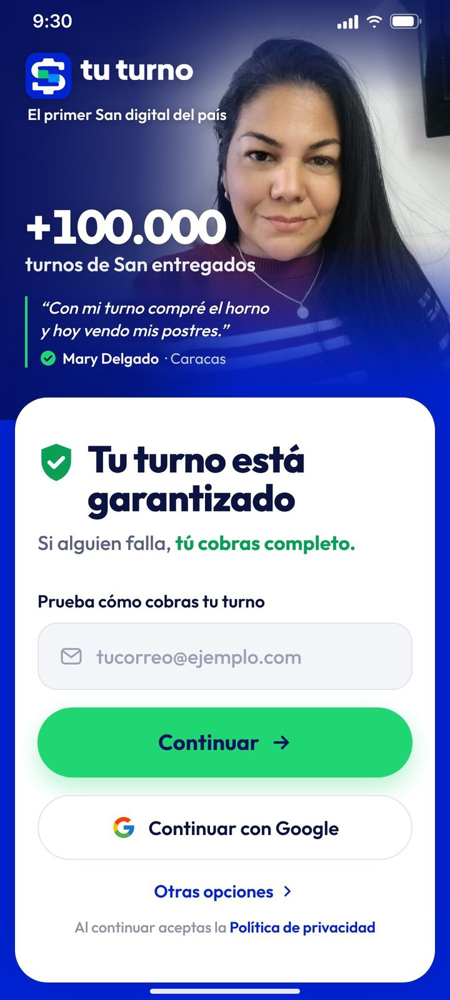</a> |
| [Ver pantalla](https://tuturno-flujo-venezuela.tiamat-agency.workers.dev/?screen=1) · [Código e instrucciones](docs/screens/1.md) |

### 2 · Código de verificación

| Pantalla principal |
| --- |
| <a href="docs/references/2.png">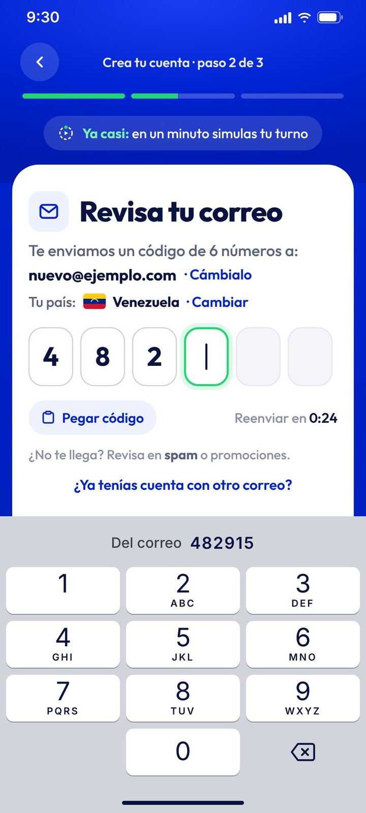</a> |
| [Ver pantalla](https://tuturno-flujo-venezuela.tiamat-agency.workers.dev/?screen=2) · [Código e instrucciones](docs/screens/2.md) |

### 3 · Clave de acceso

| Pantalla principal |
| --- |
| <a href="docs/references/3.png">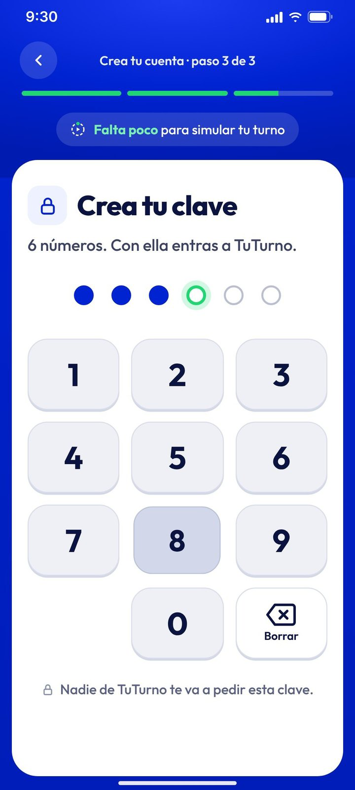</a> |
| [Ver pantalla](https://tuturno-flujo-venezuela.tiamat-agency.workers.dev/?screen=3) · [Código e instrucciones](docs/screens/3.md) |

### 4a · Bienvenida e idea elegida

| Pantalla principal | Idea elegida |
| --- | --- |
| <a href="docs/references/4a.png">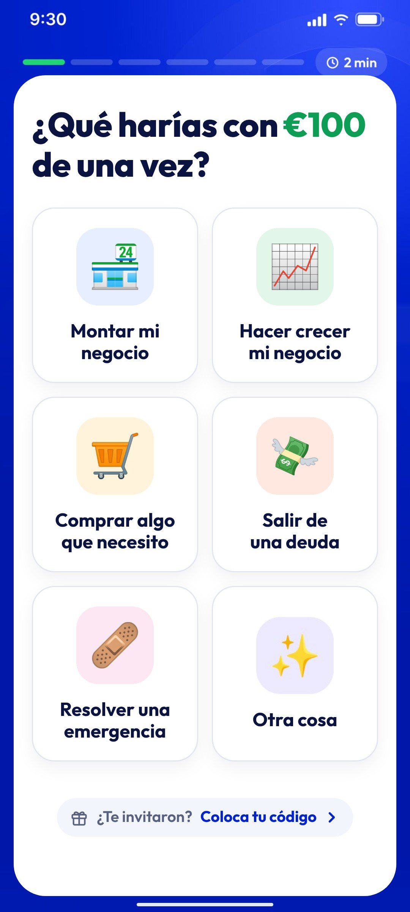</a> | <a href="docs/references/4a-selected.png">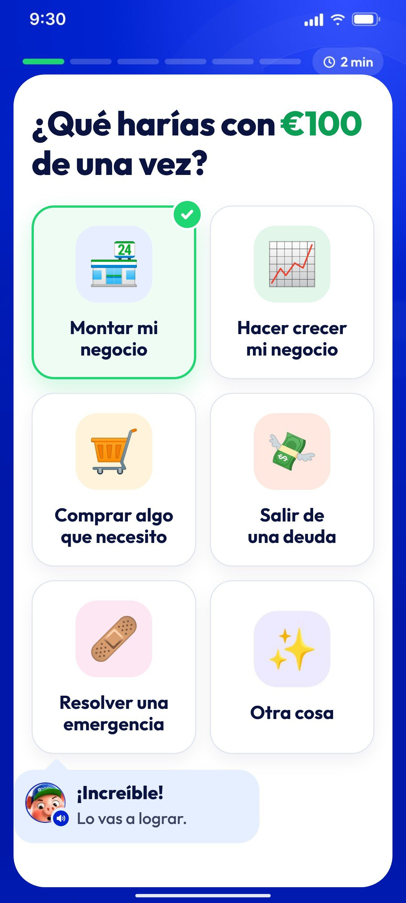</a> |
| [Ver pantalla](https://tuturno-flujo-venezuela.tiamat-agency.workers.dev/?screen=4a) · [Código e instrucciones](docs/screens/4a.md) | [Ver pantalla](https://tuturno-flujo-venezuela.tiamat-agency.workers.dev/?screen=4a&variant=selected) · [Código e instrucciones](docs/screens/4a-selected.md) |

### 4b · Avisos

| Pantalla principal |
| --- |
| <a href="docs/references/4b.png">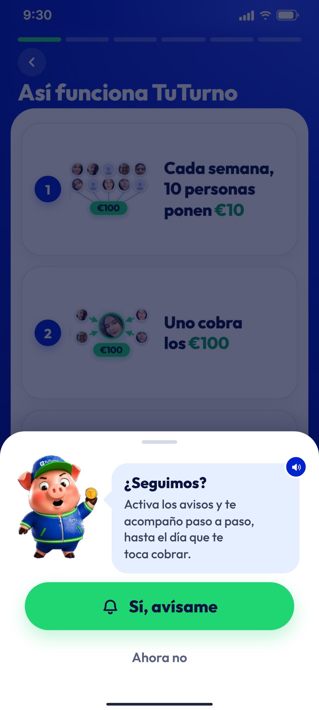</a> |
| [Ver pantalla](https://tuturno-flujo-venezuela.tiamat-agency.workers.dev/?screen=4b) · [Código e instrucciones](docs/screens/4b.md) |

### 4c · Así funciona

| Pantalla principal | Con guía | Guía: paso 2 |
| --- | --- | --- |
| <a href="docs/references/4c.png">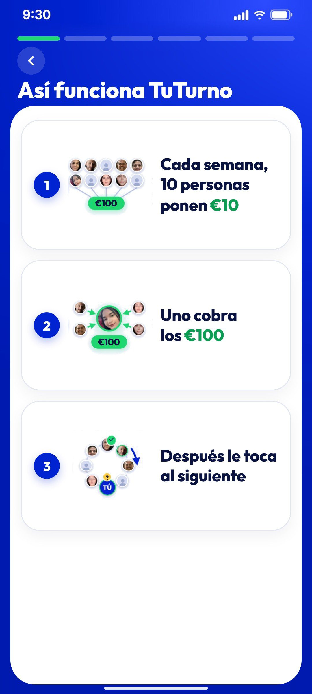</a> | <a href="docs/references/4c-1.png">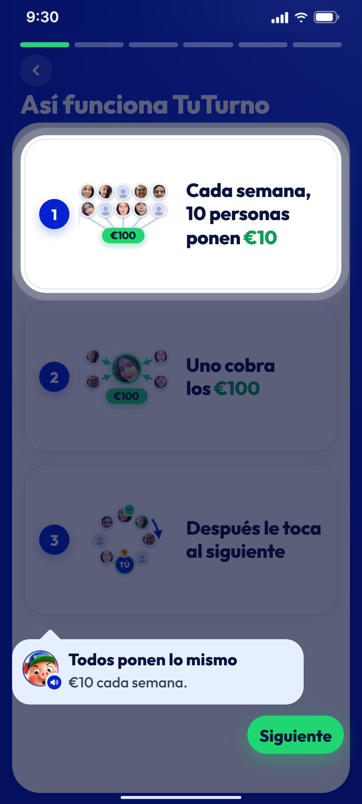</a> | <a href="docs/references/4c-2.png">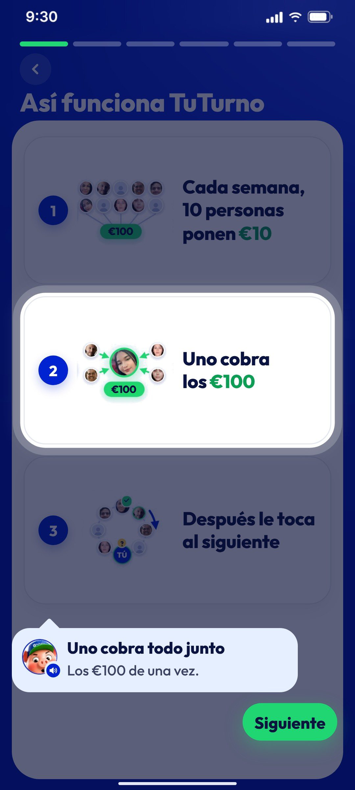</a> |
| [Ver pantalla](https://tuturno-flujo-venezuela.tiamat-agency.workers.dev/?screen=4c) · [Código e instrucciones](docs/screens/4c.md) | [Ver pantalla](https://tuturno-flujo-venezuela.tiamat-agency.workers.dev/?screen=4c&variant=guide) · [Código e instrucciones](docs/screens/4c-1.md) | [Ver pantalla](https://tuturno-flujo-venezuela.tiamat-agency.workers.dev/?screen=4c&variant=guide2) · [Código e instrucciones](docs/screens/4c-2.md) |

| Guía: paso 3 |
| --- |
| <a href="docs/references/4c-3.png">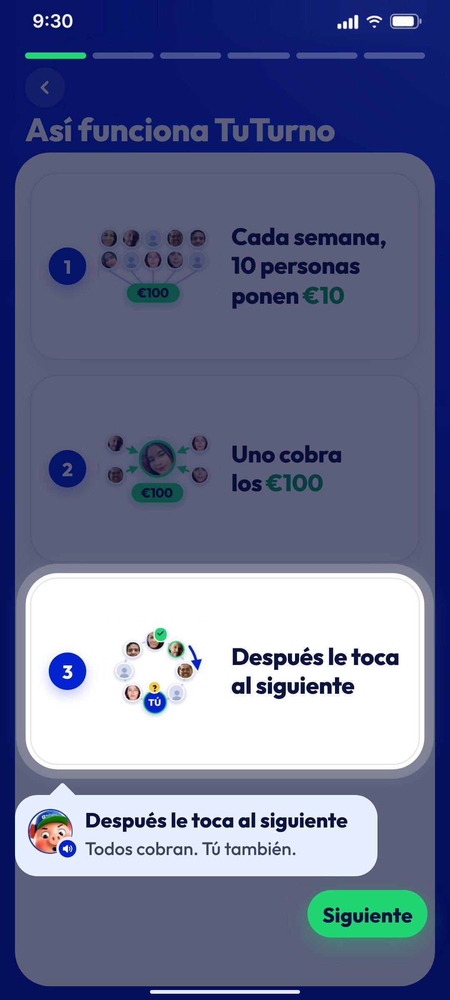</a> |
| [Ver pantalla](https://tuturno-flujo-venezuela.tiamat-agency.workers.dev/?screen=4c&variant=guide3) · [Código e instrucciones](docs/screens/4c-3.md) |

### 5 · Así pagas

| Pantalla principal | Con guía |
| --- | --- |
| <a href="docs/references/5.png">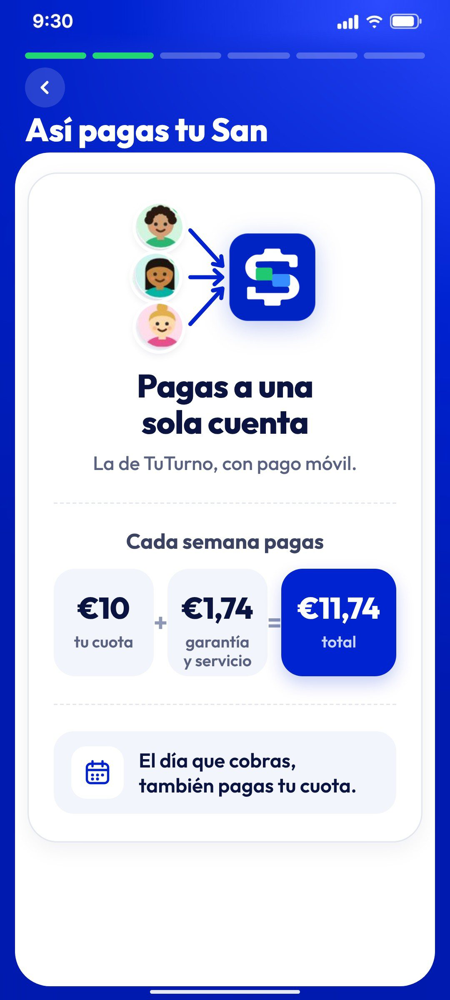</a> | <a href="docs/references/5-guide.png">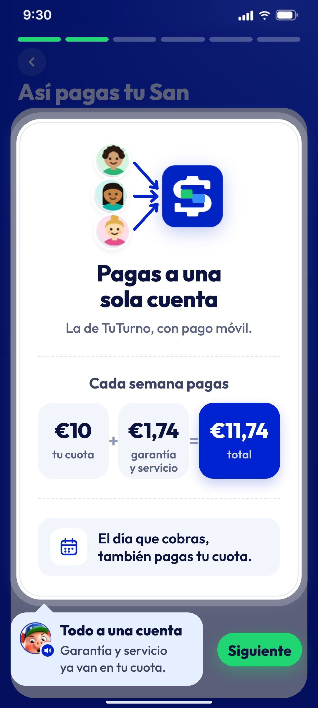</a> |
| [Ver pantalla](https://tuturno-flujo-venezuela.tiamat-agency.workers.dev/?screen=5) · [Código e instrucciones](docs/screens/5.md) | [Ver pantalla](https://tuturno-flujo-venezuela.tiamat-agency.workers.dev/?screen=5&variant=guide) · [Código e instrucciones](docs/screens/5-guide.md) |

### 6 · Reglas y rueda de práctica

| Pantalla principal | Con guía | Guía: paso 2 |
| --- | --- | --- |
| <a href="docs/references/6.png">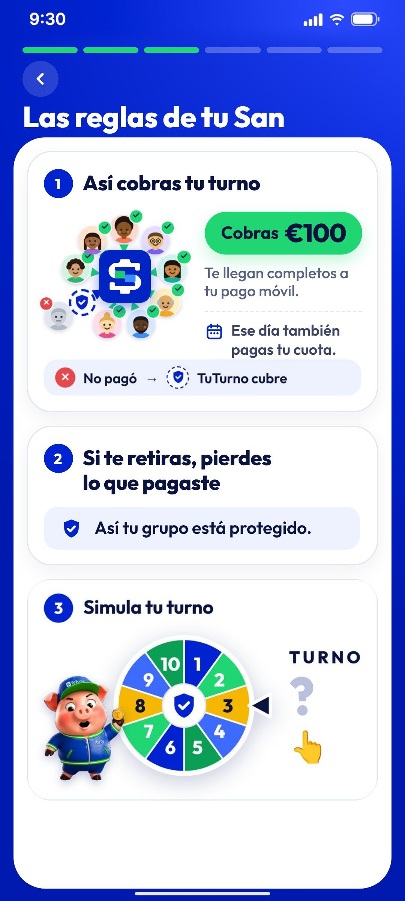</a> | <a href="docs/references/6-1.png">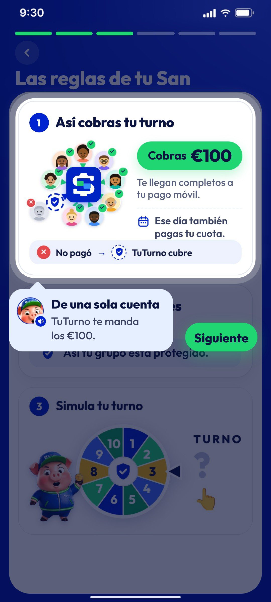</a> | <a href="docs/references/6-2.png">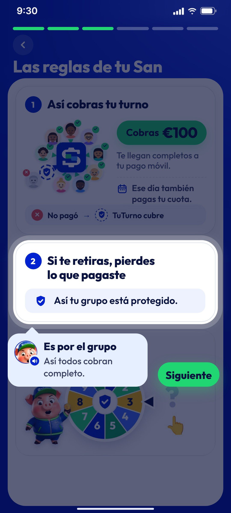</a> |
| [Ver pantalla](https://tuturno-flujo-venezuela.tiamat-agency.workers.dev/?screen=6) · [Código e instrucciones](docs/screens/6.md) | [Ver pantalla](https://tuturno-flujo-venezuela.tiamat-agency.workers.dev/?screen=6&variant=guide) · [Código e instrucciones](docs/screens/6-1.md) | [Ver pantalla](https://tuturno-flujo-venezuela.tiamat-agency.workers.dev/?screen=6&variant=guide2) · [Código e instrucciones](docs/screens/6-2.md) |

| Guía: paso 3 |
| --- |
| <a href="docs/references/6-3.png">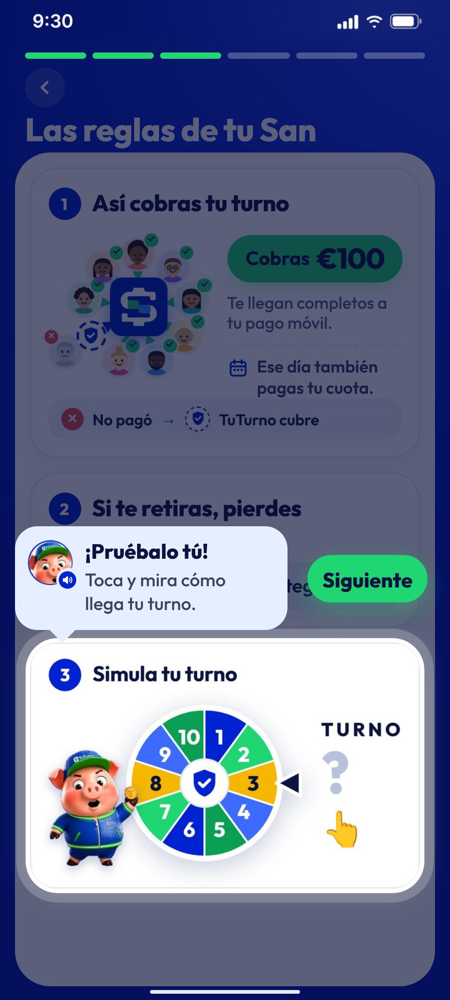</a> |
| [Ver pantalla](https://tuturno-flujo-venezuela.tiamat-agency.workers.dev/?screen=6&variant=guide3) · [Código e instrucciones](docs/screens/6-3.md) |

### 7 · Practica tu primer pago

| Pantalla principal | Con guía |
| --- | --- |
| <a href="docs/references/7.png">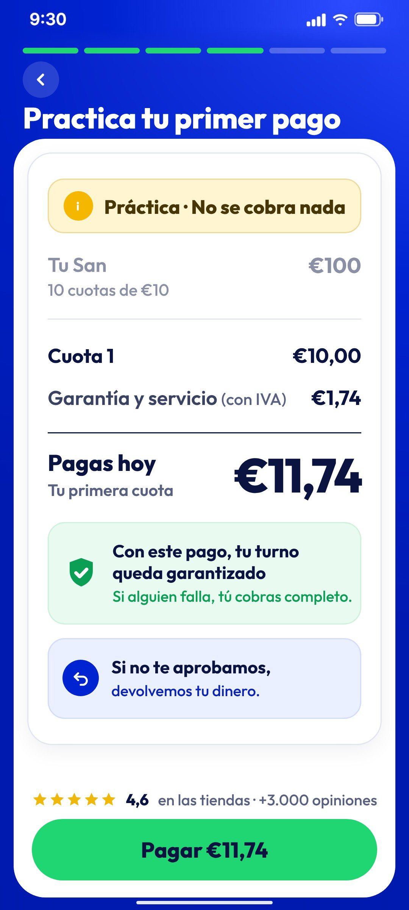</a> | <a href="docs/references/7-guide.png">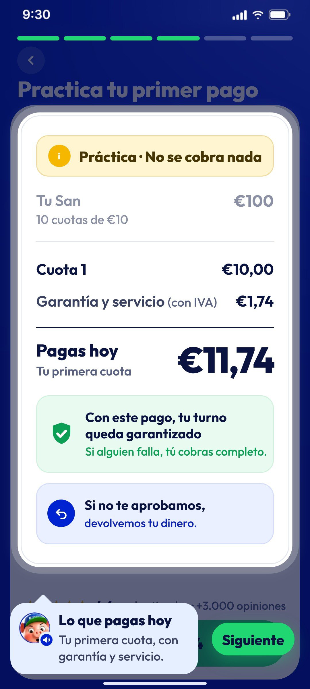</a> |
| [Ver pantalla](https://tuturno-flujo-venezuela.tiamat-agency.workers.dev/?screen=7) · [Código e instrucciones](docs/screens/7.md) | [Ver pantalla](https://tuturno-flujo-venezuela.tiamat-agency.workers.dev/?screen=7&variant=guide) · [Código e instrucciones](docs/screens/7-guide.md) |

### 7b · Práctica superada

| Pantalla principal | Con guía |
| --- | --- |
| <a href="docs/references/7b.png">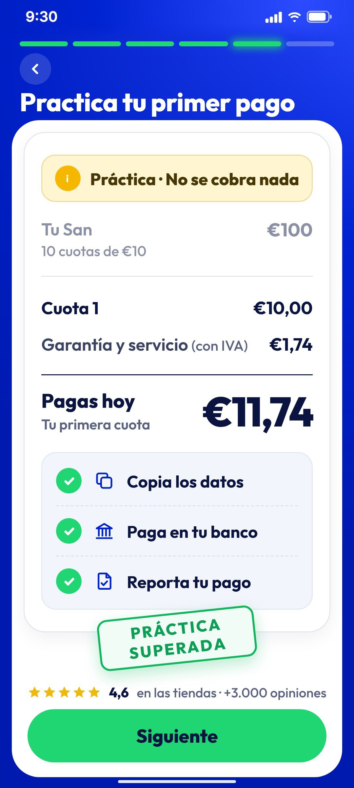</a> | <a href="docs/references/7b-guide.png">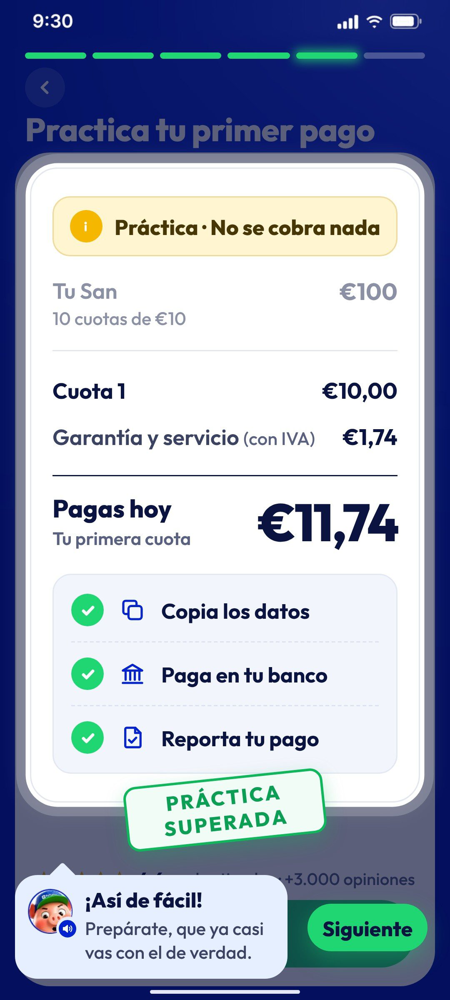</a> |
| [Ver pantalla](https://tuturno-flujo-venezuela.tiamat-agency.workers.dev/?screen=7b) · [Código e instrucciones](docs/screens/7b.md) | [Ver pantalla](https://tuturno-flujo-venezuela.tiamat-agency.workers.dev/?screen=7b&variant=guide) · [Código e instrucciones](docs/screens/7b-guide.md) |

### 8 · Verificación del grupo

| Pantalla principal | Con guía | Verificación completada |
| --- | --- | --- |
| <a href="docs/references/8.png">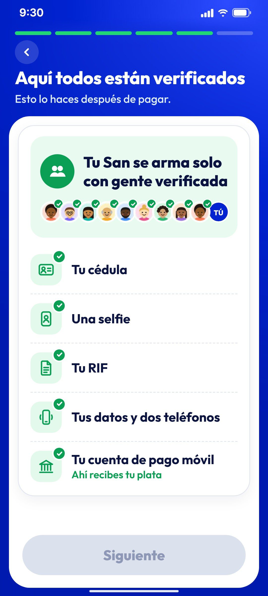</a> | <a href="docs/references/8-guide.png">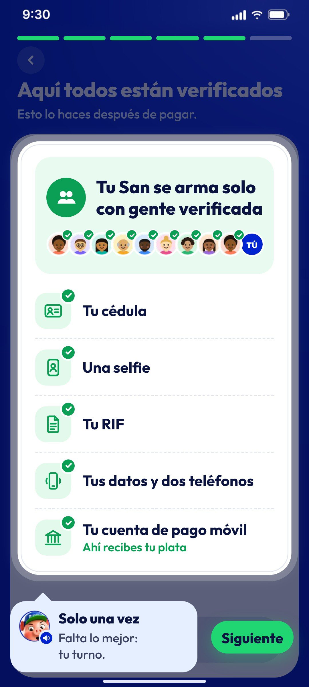</a> | <a href="docs/references/8-ready.png">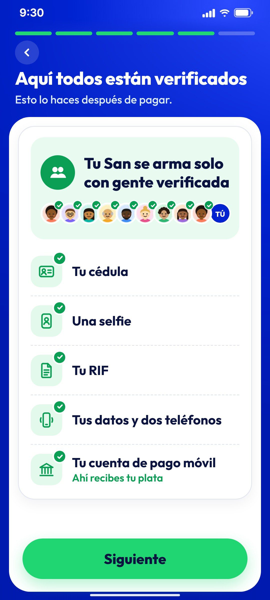</a> |
| [Ver pantalla](https://tuturno-flujo-venezuela.tiamat-agency.workers.dev/?screen=8) · [Código e instrucciones](docs/screens/8.md) | [Ver pantalla](https://tuturno-flujo-venezuela.tiamat-agency.workers.dev/?screen=8&variant=guide) · [Código e instrucciones](docs/screens/8-guide.md) | [Ver pantalla](https://tuturno-flujo-venezuela.tiamat-agency.workers.dev/?screen=8&variant=ready) · [Código e instrucciones](docs/screens/8-ready.md) |

### 9 · Cierre y tiquera

| Pantalla principal |
| --- |
| <a href="docs/references/9.png">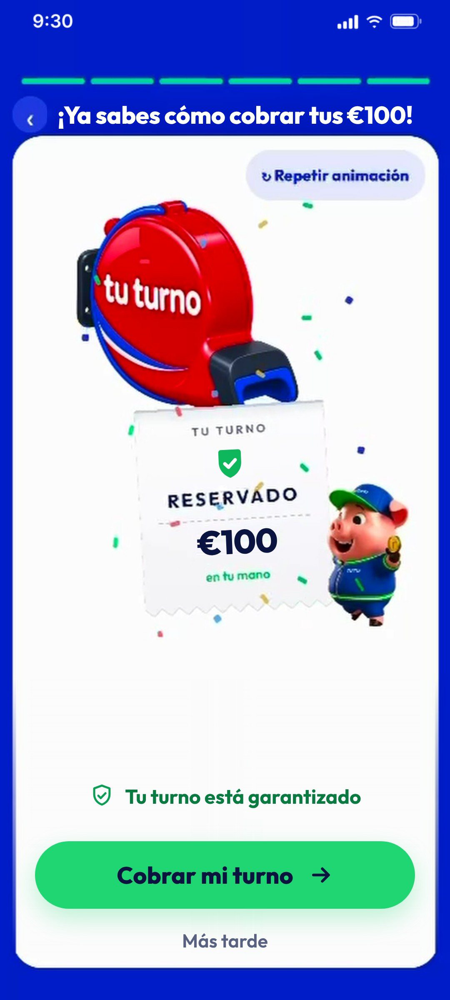</a> |
| [Ver pantalla](https://tuturno-flujo-venezuela.tiamat-agency.workers.dev/?screen=9) · [Código e instrucciones](docs/screens/9.md) |

### 10 · Escoge tu San

| Pantalla principal | Otra cosa: sin frase |
| --- | --- |
| <a href="docs/references/10.png">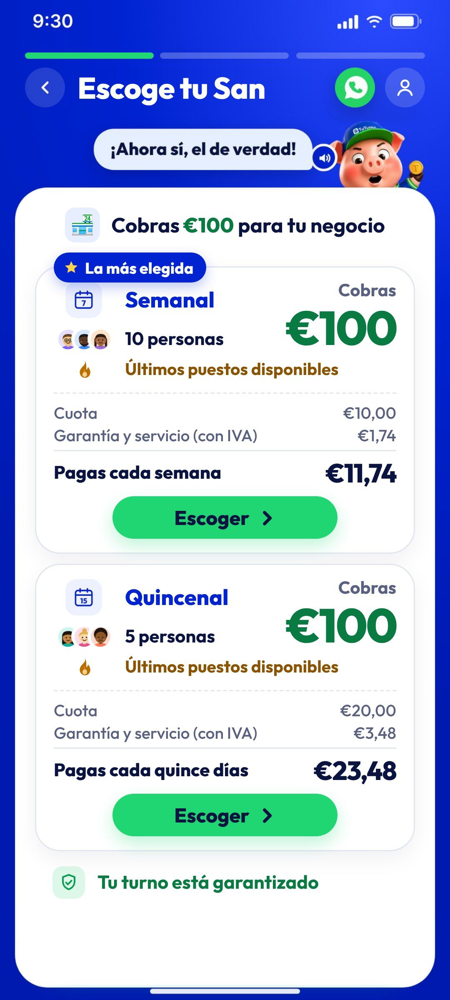</a> | <a href="docs/references/10-other.png">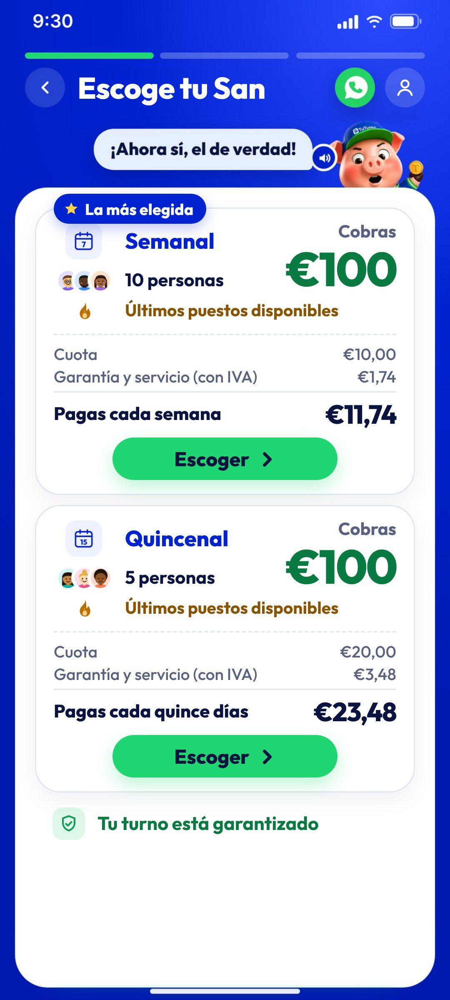</a> |
| [Ver pantalla](https://tuturno-flujo-venezuela.tiamat-agency.workers.dev/?screen=10) · [Código e instrucciones](docs/screens/10.md) | [Ver pantalla](https://tuturno-flujo-venezuela.tiamat-agency.workers.dev/?screen=10&variant=other) · [Código e instrucciones](docs/screens/10-other.md) |

### 11 · Lo que aceptas

| Pantalla principal |
| --- |
| <a href="docs/references/11.png">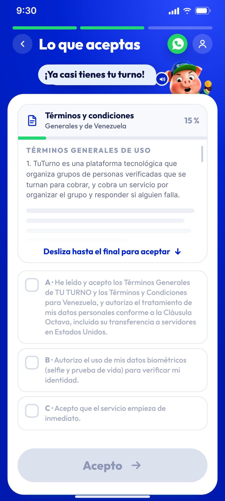</a> |
| [Ver pantalla](https://tuturno-flujo-venezuela.tiamat-agency.workers.dev/?screen=11) · [Código e instrucciones](docs/screens/11.md) |

### 11b · Consentimientos listos

| Pantalla principal |
| --- |
| <a href="docs/references/11b.png">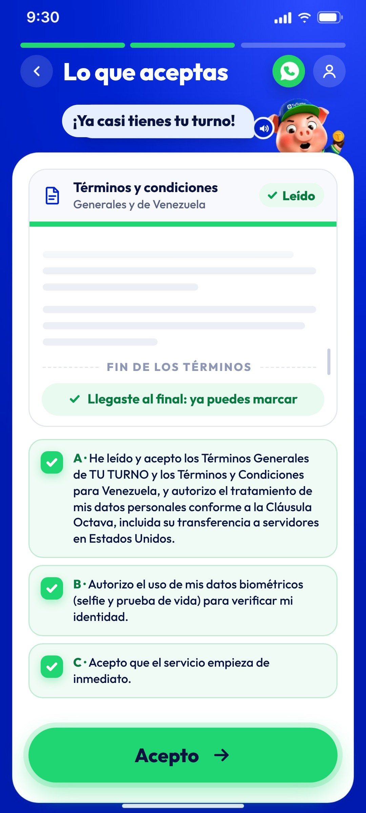</a> |
| [Ver pantalla](https://tuturno-flujo-venezuela.tiamat-agency.workers.dev/?screen=11b) · [Código e instrucciones](docs/screens/11b.md) |

### 12 · Tu primer pago

| Pantalla principal | Otra cosa: sin frase |
| --- | --- |
| <a href="docs/references/12.png">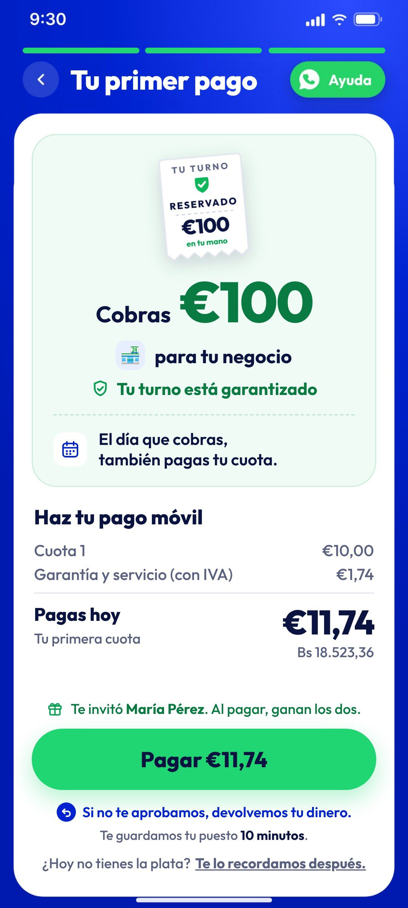</a> | <a href="docs/references/12-other.png">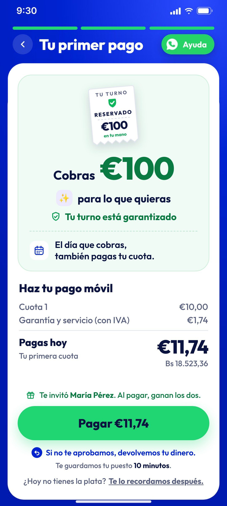</a> |
| [Ver pantalla](https://tuturno-flujo-venezuela.tiamat-agency.workers.dev/?screen=12) · [Código e instrucciones](docs/screens/12.md) | [Ver pantalla](https://tuturno-flujo-venezuela.tiamat-agency.workers.dev/?screen=12&variant=other) · [Código e instrucciones](docs/screens/12-other.md) |

### 12c · Pago no completado

| Pantalla principal |
| --- |
| <a href="docs/references/12c.png">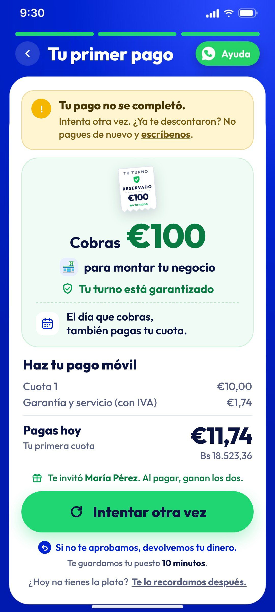</a> |
| [Ver pantalla](https://tuturno-flujo-venezuela.tiamat-agency.workers.dev/?screen=12c) · [Código e instrucciones](docs/screens/12c.md) |

### 12d · Recordatorio

| Pantalla principal |
| --- |
| <a href="docs/references/12d.png">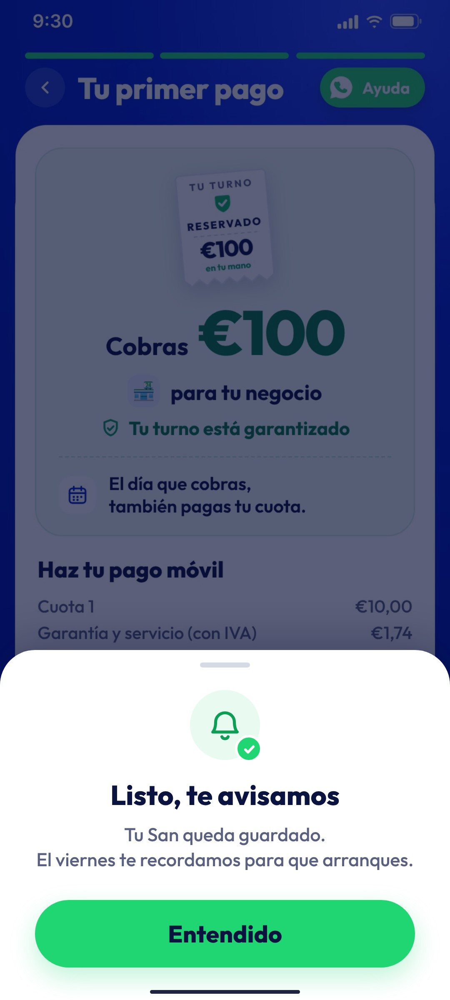</a> |
| [Ver pantalla](https://tuturno-flujo-venezuela.tiamat-agency.workers.dev/?screen=12d) · [Código e instrucciones](docs/screens/12d.md) |

### 13 · ChinChin: referencia externa

| Pantalla principal |
| --- |
| <a href="docs/references/13.png">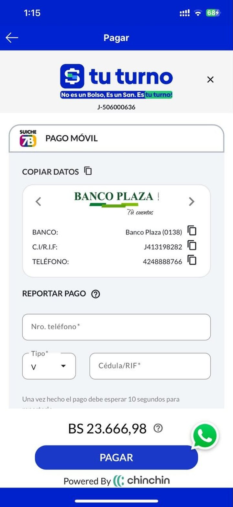</a> |
| [Ver pantalla](https://tuturno-flujo-venezuela.tiamat-agency.workers.dev/?screen=13) · [Código e instrucciones](docs/screens/13.md) |

## Instalación, ejecución y verificación

```sh
npm ci
npm run dev
npm run check
npm run build
npm run preview
```

Usa Node.js 22.18 o posterior. Las pruebas del flujo utilizan el compilador TypeScript instalado, incluso en distribuciones de Node sin soporte nativo para TypeScript. El servidor de desarrollo escucha en el puerto 5210. React 19 y React Native Web generan la interfaz del navegador; Vite compila el sitio. React Native aporta los tipos de desarrollo de los componentes visuales compartidos. El proyecto no contiene dependencias ni API de Expo, configuración de Metro ni proyectos de iOS o Android.

`npm run check` verifica los tipos, el español neutro, los precios, el retroceso por los pasos del paseo, la conservación de los consentimientos, los quince audios locales y la ausencia de dependencias de Expo.

Para revisar el registro usa el código `482915`. Crea y repite cualquier clave válida de seis dígitos, por ejemplo `628194`. El entorno de revisión no envía correos, no guarda la clave, no cobra ni crea un estado de pago exitoso. Puedes abrir estados concretos con `?screen=4c&variant=guide2` y revisar una idea con `?screen=12&idea=2`. Al abrir normalmente después del registro, el recorrido vuelve a 4a y conserva el San elegido. `?lector=1` permite que una integración accesible suprima la voz. La reproducción automática del navegador puede necesitar una primera pulsación. El silencio se conserva entre pantallas.

## Integración con producción

La autenticación real se conecta mediante `RegistrationServices`. El pago necesita una orden HTTPS válida de ChinChin y la confirmación de su resultado; el navegador no calcula una tasa de cambio. El ejemplo semanal muestra el importe en bolívares de la guía; el quincenal espera una orden real. Los recordatorios de los viernes requieren implementar `FlowServices.scheduleReminders`. La pantalla 13 pertenece al proveedor ChinChin y se conserva como referencia. El propietario dejó pendiente el texto legal completo, que deberá aportar la integración.

Los navegadores no permiten detectar de forma fiable el modo silencio del dispositivo ni el lector de pantalla. Las integraciones nativas deben aplicar esas políticas. Con movimiento reducido, las animaciones terminan de inmediato y la narración sigue disponible. Solo producen sonido la voz y el efecto propuesto del motor de la impresora. La voz elegida por Oscar es `J3IVA4gky83c6u110Yk6`; el repositorio no incluye credenciales. El audio 4a ajusta su velocidad sin cambiar el tono para terminar antes del avance automático de 1,5 segundos. Las demás duraciones siguen el habla natural; el texto de 4b supera el objetivo aproximado de 3–5 segundos. Consulta las duraciones exactas en el manifiesto de audio.

El logo SVG conserva sin pérdida el símbolo de la marca suministrado y utiliza trazados vectoriales para el nombre. El cuerpo y el frente de la tiquera conservan el dibujo aprobado. El vidrio, el rollo, la boca, el papel, el confeti y Tutu se identifican por separado en el código y en el mapa de recursos.

## Última revisión de la v20

Las pantallas 10, 12, 12c y 12d muestran la idea completa. La 10 utiliza un encabezado de dos líneas; «Otra cosa» elimina todo ese encabezado. En el pago se conservan el tiquete y el título de €100, y se elimina la fila de la idea cuando corresponde «Otra cosa». Las narraciones y los precios no cambian. Storybook muestra este mismo código publicado mediante un puente que comprueba el origen de los mensajes de audio y captura.

## Evidencia de la entrega

- `docs/reference-manifest.json`: las 33 imágenes originales, con página, referencia interna y huella SHA256.
- `docs/verification/interaction.json`: recorrido completo de registro, práctica, consentimientos, pago quincenal, fallo y recordatorio; incluye la conservación del silencio.
- `docs/verification/latest-v20/`: revisión de las 24 combinaciones de pantalla e idea a 360 × 800 y comprobación de audio, captura y contexto en Storybook.
- `assets/audio/manifest.json`: correspondencia de los quince textos y archivos de voz, con sus duraciones, canales y huellas.
- `docs/delivery-links.json`: valores de los campos del PDF y sus destinos reales.

## Idioma del repositorio

La documentación, los comentarios, las instrucciones y los mensajes propios del proyecto se mantienen en español neutro. Los nombres técnicos de bibliotecas, comandos, rutas y contratos de integración conservan su escritura para asegurar compatibilidad. Las licencias de terceros se conservan en su versión original.

## Guía vigente: transcripción completa

A continuación se conserva el texto suministrado como requisito del producto. Las pantallas enlazan a las imágenes originales extraídas del PDF. Esta guía sustituye a la v19. Se omiten las etiquetas del formulario y el pie repetido porque se conservan en el PDF entregable.

### Página 1

SOLO PARA OSCAR
TuTurno · Venezuela · v20 · 17 de noviembre de 2026
Flujo del usuario nuevo,
de la pantalla 1 al pago
Versión 20: trae las correcciones de la revisión del 17-nov. Reemplaza al PDF
v19 completo.
LA REGLA
Se implementa tal cual.
Cada pantalla se trabajó una por una con Maurizio: textos, tamaños, colores y orden
ya están aprobados.
Si ves una mejora o algo que no te convence, no lo cambies: anótalo en
«Observaciones» de esa pantalla y lo evaluamos con Maurizio antes de tocar.
No lo pases por otra herramienta ni por una IA para cambiarlo por tu cuenta.
QUÉ DEVUELVES
En cada pantalla: el enlace de GitHub de
la animación, los logos e íconos y los
colores. Los campos de este PDF se
pueden llenar: escríbelos aquí y
devuélvelo.
QUÉ PASA DESPUÉS
Comparamos tu entrega contra este
diseño. Si todo está bien, sale un solo
documento para Limonbyte con el diseño
y tus enlaces juntos.
QUÉ TRAE ESTE PDF
2
Qué cambió desde la v19
5
Mapa del flujo
3
Reglas para todas las pantallas
6–24 Una página por pantalla, con tus campos
4 Tutu: dónde habla y qué suena
25
Lo que entregas
Si ya empezaste con la v19, mira primero la página 2: ahí está todo lo que cambió.
No entra aquí: San Experto (segundo San) ni el flujo de Colombia; van en otra entrega.

### Página 2

Qué cambió desde la v19
Revisión del 17-nov. Todo lo demás queda igual que en la v19.
4a
Bienvenida
Solo la pregunta y seis ideas nuevas con dibujo grande. Salen la cara de Daniela y «Gente como tú ya
cobró su turno». Sin botón: al tocar, verde, vibra, Tutu dice «¡Increíble! Lo vas a lograr.» y pasa sola. El
código, abajo en chiquito.
4b
Avisos
«¿Seguimos?» y «Activa los avisos y te acompaño paso a paso, hasta el día que te toca cobrar.» El
botón sigue «Sí, avísame».
4c
Así funciona
Pantalla propia, como la 5 y la 6: título «Así funciona TuTurno», tres pasos grandes y numerados, y
Tutu abajo con «Siguiente» en cada paso. Salen la cara, el código, la idea con «Cambiar» y «Cobrar mi
turno». Flecha de atrás.
5
Así pagas
Debajo del €1,74: «garantía y servicio». Tutu: «Garantía y servicio ya van en tu cuota.»
7
Práctica
Título «Practica tu primer pago». Aviso arriba, en grande: «Práctica · No se cobra nada». «Garantía y
servicio (con IVA)». Tutu: «Tu primera cuota, con garantía y servicio.»
7b
Práctica superada
Los tres pasos del pago de verdad se marcan solos. Sello «Práctica superada» y botón «Siguiente».
8
Verificados
Título «Aquí todos están verificados». Arriba, el grupo con las caras; debajo, la lista más chica. Botón
«Siguiente» en vez de «Empezar».
9
Tiquetera
Titular «¡Ya sabes cómo cobrar tus €100!».
10
Escoge tu San
«La más elegida» en el semanal. Sale «Si te retiras». «Garantía y servicio». Arriba, la idea completa:
«Cobras €100 · para montar tu negocio».
12
Pago · 12c · 12d
«Garantía y servicio (con IVA)» y la idea completa que tocó. Con «Otra cosa», sin frase.
SIN CAMBIOS
1, 2, 3, 6, 11, 11b y 13.
AUDIOS DE TUTU
Nuevos: tutu_4a, tutu_4c_1, tutu_4c_2 y tutu_4c_3.
Se regraban porque cambió el texto: tutu_4b, tutu_5, tutu_7 y
tutu_9.
Quedan 15 audios en total (página 4).
REGLAS NUEVAS
Tutu va abajo explicando, siempre que se pueda.
El cobro de €1,74 se llama igual en todas partes: «garantía y
servicio».
La cifra es una sola en toda la app: «+100.000 turnos
entregados».
La 4a no lleva botón: tocar la idea es la acción.
PARA LIMONBYTE, NO PARA TI
Guardar qué idea toca cada uno en la 4a y medir pantalla por
pantalla al lanzar.
Se quita la ventana de datos bancarios antes del pago: la cuenta
se pide en la verificación.

### Página 3

Reglas para todas las pantallas
Lo que vale en todo el flujo. Lo propio de cada pantalla va en su página.
NUMERACIÓN
1 a 13: el flujo nuevo, en orden.
Letras (4a, 4b, 4c, 7b, 11b, 12c, 12d): momentos o casos de la misma pantalla.
«· 1, · 2, · 3», «· fin» y «· otra»: estados dentro de una pantalla.
H1 a H13: la app de hoy, para que sepas qué reemplaza cada una.
MEDIDAS Y LETRA
Diseño a 360 × 800; imágenes a 1080 × 2400.
Outfit, de 400 a 800 (montos grandes en 800). Texto legal en Inter.
Botón principal: verde, 54 de alto, píldora. Apagado: gris #DCE1EE.
MONEDA Y PALABRAS
Todo en euros (€). Bolívares solo en la 12, sacados de la orden de ChinChin.
Siempre «San». Nunca «sorteo», «suerte» ni «apuesta». Nunca prometer el primer turno.
El cobro de €1,74 se llama siempre «garantía y servicio».
CÓMO SE MUEVE
Mientras no haya pagado, al abrir la app arranca en la 4a. «Más tarde» en la 9 también vuelve a la 4a.
La 4a no tiene botón: al tocar una idea pasa sola. Flecha atrás de la 4c a la 9: cada toque devuelve un
paso; al volver, lo animado aparece ya terminado.
«Reducir movimiento» activo: nada se anima, todo aparece terminado. La voz de Tutu sí suena.
WhatsApp: nada de la 1 a la 9. Desde la 10, arriba a la derecha (en la 12, «Ayuda»). El perfil aparece
desde la 10.
EL PASEO (4 A 9)
La pantalla sale y, 1 s después, llega la luz: velo #060C34 al 66 % sobre todo menos lo que se explica,
que lleva borde blanco y halo.
Con cada «Siguiente» la luz se desliza (≈ 0,3 s) y lo iluminado late una vez (crece 3 % y vuelve).
Nube de Tutu: 218 de ancho (290 en la 4c), celeste #E6EFFF, con su cara y la bocina. «Siguiente» verde a
la derecha (en la 4c, debajo).
Tutu va abajo explicando, siempre que se pueda. En las versiones sin resaltar no va la nube.
SIN ESPACIO MUERTO (15-NOV)
El contenido crece hasta llenar la hoja blanca.
La nube de Tutu va abajo aunque tape el botón de la pantalla: manda el «Siguiente» de la nube (se ve en
la 7, la 7b y la 8).
COLORES
Azul TuTurno
#0023D1
Verde botón
#20D672
Celeste
#359BFF
Gris claro
#EDEDED
Texto navy
#0B1340
Verde de texto
#0A9F55
Nube de Tutu
#E6EFFF
Velo del paseo
#060C34 · al 66 %

### Página 4

Tutu: dónde habla y qué suena
Su cara, sus textos exactos y los dos únicos sonidos del flujo.
LA CARA REAL DE TUTU, EN TODAS LAS NUBES
La cara que ves en las nubes de estos diseños es de relleno y no se ve bien. Tú
tienes la buena: ponla en todas.
Tutu de cuerpo entero: 4b, 6 · 3 (empujando la rueda) y 9 (celebrando).
Asomado detrás de la hoja: 10 y 11.
Nunca en el pago (12, 12c, 12d) ni en la garantía.
SOLO DOS SONIDOS EN TODO EL FLUJO
La voz de Tutu, un audio por nube (tabla de la derecha). Voz de caricatura
de cochinito, alegre y clara, con acento venezolano. Lee la nube palabra
por palabra.
Tocar la cara de Tutu o la bocina lo calla o lo repite; si lo calla, queda
callado. Respeta el modo silencio. Con lector de pantalla activo no suena.
El «ri-ri-ri» de la impresora de la tiquetera, en la 9.
Nada más suena: ni la rueda, ni el sello, ni los checks, ni los botones (solo
vibraciones suaves).
DÓNDE HABLA TUTU · TEXTO EXACTO
PANTALLA
DÓNDE
LO QUE DICE
AUDIO
4a
Nube, al tocar
¡Increíble! Lo vas a lograr.
NUEVO
tutu_4a_ve
4b
Ventana de avisos ¿Seguimos? Activa los avisos y te acompaño paso a paso, hasta el día que te toca cobrar.
SE REGRABA
tutu_4b_ve
4c · 1
Nube
Todos ponen lo mismo €10 cada semana.
NUEVO
tutu_4c_1_ve
4c · 2
Nube
Uno cobra todo junto Los €100 de una vez.
NUEVO
tutu_4c_2_ve
4c · 3
Nube
Después le toca al siguiente Todos cobran. Tú también.
NUEVO
tutu_4c_3_ve
5
Nube
Todo a una cuenta Garantía y servicio ya van en tu cuota.
SE REGRABA
tutu_5_ve
6 · 1
Nube
De una sola cuenta TuTurno te manda los €100.
tutu_6_1_ve
6 · 2
Nube
Es por el grupo Así todos cobran completo.
tutu_6_2_ve
6 · 3
Nube
¡Pruébalo tú! Toca y mira cómo llega tu turno.
tutu_6_3_ve
7
Nube
Lo que pagas hoy Tu primera cuota, con garantía y servicio.
SE REGRABA
tutu_7_ve
7b
Nube
¡Así de fácil! Prepárate, que ya casi vas con el de verdad.
tutu_7b_ve
8
Nube
Solo una vez Falta lo mejor: tu turno.
tutu_8_ve
9
Solo voz
¡Ya sabes cómo cobrar tus €100!
SE REGRABA
tutu_9_ve
10
Asomado arriba
¡Ahora sí, el de verdad!
tutu_10_ve
11
Asomado arriba
¡Ya casi tienes tu turno!
tutu_11_ve
15 audios (4 nuevos y 4 que se regraban), mono, AAC o MP3 de ≈ 64 kbps, 3 a 5 s. Si cambia un texto, se regraba su audio. Maurizio aprueba la voz antes de
grabar todos.
PROVISIONAL · VA LA BUENA

### Página 5

Mapa del flujo
De la pantalla 1 al pago, en orden. Cada una tiene su página.
1
Inicio
2
Código
3
Clave
4a
Bienvenida
4b
Avisos
4c
Así funciona
5
Así pagas
6
Reglas
7
Práctica
7b
Práctica
superada
8
Verificados
9
Tiquetera
10
Escoge tu San
11
Lo que aceptas
11b
Listo para
aceptar
12
Tu primer pago
13
ChinChin
12c
Si el pago falla
12d
Te lo
recordamos
Camino normal
Si algo pasa en el pago
Paseo de práctica: 4a a 9 · Flujo real: 10 a 13

### Página 6

1
Inicio
Reemplaza a H1 «Inicio de sesión», H2 «¿De qué país eres?» y H3 «Ingresa tu correo»
1 · FINAL
QUÉ HACE
Arriba, la prueba: «+100.000 turnos de San entregados» (sale de la base de
datos y solo sube) y una persona real con su frase, nombre y ciudad.
La garantía: «Tu turno está garantizado» y «Si alguien falla, tú cobras
completo.»
Un solo campo de correo. «Continuar» se activa con un correo válido: si ya
existe, pide la clave; si es nuevo, manda el código y abre la 2.
«Continuar con Google» (con Apple en iPhone) y «Otras opciones».
TUTU DICE
Tutu no habla en esta pantalla.
ANIMACIÓN Y MOVIMIENTO
Sin luz de paseo: solo la respuesta al toque.
El carrusel de personas cambia cada 5 s.
SONIDO
Ninguno.
ÚLTIMO CAMBIO
Sin cambios en la v20. La cifra es una sola en toda la app: «+100.000
turnos entregados».
VA A
2 · Código (o la clave, si el correo ya existe)
PARA LLENAR · OSCAR
Escribe aquí mismo: los campos se pueden llenar.
GitHub · animación
Logos e íconos (enlace)
Colores usados
Observaciones · se evalúan con Maurizio antes de tocar

[1](docs/references/1.png)

### Página 7

2
Código
Reemplaza a H4 «Revisa tu correo». El país de H2 queda aquí, ya marcado.
2 · FINAL
QUÉ HACE
Arriba: «Crea tu cuenta · paso 2 de 3» y «Ya casi: en un minuto simulas tu
turno».
El correo con «Cámbialo» y el país: «Tu país: Venezuela · Cambiar».
Seis casillas; el teléfono autocompleta el código. Al sexto número valida y
avanza solo.
Si está malo: rojo, vibración y se borra. «Pegar código». Reenviar a los 30 s.
TUTU DICE
Tutu no habla en esta pantalla.
ANIMACIÓN Y MOVIMIENTO
Sin luz de paseo: solo la respuesta al toque.
SONIDO
Ninguno.
ÚLTIMO CAMBIO
Sin cambios en la v20.
VA A
3 · Clave
PARA LLENAR · OSCAR
Escribe aquí mismo: los campos se pueden llenar.
GitHub · animación
Logos e íconos (enlace)
Colores usados
Observaciones · se evalúan con Maurizio antes de tocar

[2](docs/references/2.png)

### Página 8

3
Clave
Reemplaza a H5 «Crea tu contraseña»
3 · FINAL
QUÉ HACE
«Crea tu clave»: 6 números con teclado propio grande (hay usuarios mayores).
Al sexto número, en la misma pantalla: «Repite tu clave». Si no coinciden:
vibración, puntos en rojo y vuelve a empezar.
«Falta poco para simular tu turno» arriba y «Nadie de TuTurno te va a pedir
esta clave» abajo.
TUTU DICE
Tutu no habla en esta pantalla.
ANIMACIÓN Y MOVIMIENTO
La tecla se hunde al tocarla, con vibración ligera.
SONIDO
Ninguno.
ÚLTIMO CAMBIO
Sin cambios en la v20.
VA A
4a · Bienvenida
PARA LLENAR · OSCAR
Escribe aquí mismo: los campos se pueden llenar.
GitHub · animación
Logos e íconos (enlace)
Colores usados
Observaciones · se evalúan con Maurizio antes de tocar

[3](docs/references/3.png)

### Página 9

4a
Bienvenida
Reemplaza a H8 «Inicio de la app» mientras no haya pagado
4A · AL ENTRAR
4A · AL TOCAR UNA IDEA
QUÉ HACE
«¿Qué harías con €100 de una vez?» y seis ideas con dibujo grande: Montar mi
negocio, Hacer crecer mi negocio, Comprar algo que necesito, Salir de una deuda,
Resolver una emergencia y Otra cosa.
Sin botón: al tocar una idea se pone verde con check, vibra, Tutu dice «¡Increíble! Lo
vas a lograr.» y a 1,5 s pasa sola.
Abajo, chiquito: «¿Te invitaron? Coloca tu código» (hasta que lo coloque o pague; no
sale si llegó por link).
Se guarda la idea que tocó: la usan la 10 y la 12.
TUTU DICE · TEXTO EXACTO
4A
¡Increíble!
Lo vas a lograr.
ANIMACIÓN Y MOVIMIENTO
A los 5 s sin tocar, las ideas laten suave, una vez.
SONIDO
Voz de Tutu al tocar una idea (tutu_4a, nuevo).
ÚLTIMO CAMBIO
Salen la cara de Daniela y «Gente como tú ya cobró su turno» (esa prueba ya sale
en la 1). Ideas nuevas, Tutu reacciona y no hay botón (17-nov).
LO TUYO AQUÍ
Dibujos de referencia: si los rehaces, mismo estilo y grandes.
VA A
4b (si el teléfono pide permiso de avisos) o 4c
PARA LLENAR · OSCAR
Escribe aquí mismo: los campos se pueden llenar.
GitHub · animación
Logos e íconos (enlace)
Colores usados
Observaciones · se evalúan con Maurizio antes de tocar

[4a](docs/references/4a.png) · [4a-selected](docs/references/4a-selected.png)

### Página 10

4b
Tutu pide los avisos
No existe hoy (hoy se piden 4 permisos juntos en H6)
4B · FINAL
QUÉ HACE
Es la ventana del permiso de avisos, con Tutu de cuerpo entero adentro. No es la nube
del paseo.
Sale después de tocar una idea, encima de la 4c, solo si el teléfono pide permiso
(Android 13+ y iPhone).
«Sí, avísame» abre el permiso del teléfono. «Ahora no» (chiquito) sigue a la 4c.
Si dice que no, la segunda oportunidad es el link «¿Hoy no tienes la plata?» de la 12.
TUTU DICE · TEXTO EXACTO
4B
¿Seguimos?
Activa los avisos y te acompaño paso a paso, hasta el día que te toca cobrar.
ANIMACIÓN Y MOVIMIENTO
La ventana sube desde abajo; atrás queda la 4c bajo el velo.
SONIDO
Voz de Tutu (tutu_4b, se regraba).
ÚLTIMO CAMBIO
Título «¿Seguimos?» y mensaje nuevo. El botón sigue «Sí, avísame», para que se
entienda que es un permiso (17-nov).
VA A
4c · Así funciona TuTurno
PARA LLENAR · OSCAR
Escribe aquí mismo: los campos se pueden llenar.
GitHub · animación
Logos e íconos (enlace)
Colores usados
Observaciones · se evalúan con Maurizio antes de tocar

[4b](docs/references/4b.png)

### Página 11

4c
Así funciona TuTurno
No existe hoy
4C · SIN RESALTAR
4C · 1 · PASO 1
4C · 2 · PASO 2
4C · 3 · PASO 3
QUÉ HACE
Título «Así funciona TuTurno». Flecha de atrás para cambiar de idea.
Tres pasos grandes y numerados: 1 «Cada semana, 10 personas ponen €10» · 2 «Uno
cobra los €100» · 3 «Después le toca al siguiente».
La luz pasa por cada paso con el «Siguiente» de la nube; con el del paso 3 pasa sola a
la 5.
TUTU DICE · TEXTO EXACTO
4C·1
Todos ponen lo mismo
€10 cada semana.
4C·2
Uno cobra todo junto
Los €100 de una vez.
4C·3
Después le toca al siguiente
Todos cobran. Tú también.
ANIMACIÓN Y MOVIMIENTO
La luz llega 1 s después (o al cerrar la 4b) y se desliza entre pasos. Nube de 290 de
ancho; «Siguiente» debajo, a la derecha.
SONIDO
Voz de Tutu en cada paso (tutu_4c_1 a tutu_4c_3, nuevos).
ÚLTIMO CAMBIO
Salen la cara, el código, la idea con «Cambiar» y «Cobrar mi turno» (17-nov).
VA A
5 · Así pagas tu San
PARA LLENAR · OSCAR
Escribe aquí mismo: los campos se pueden llenar.
GitHub · animación
Logos e íconos (enlace)
Colores usados
Observaciones · se evalúan con Maurizio antes de tocar

[4c](docs/references/4c.png) · [4c-1](docs/references/4c-1.png) · [4c-2](docs/references/4c-2.png) · [4c-3](docs/references/4c-3.png)

### Página 12

5
Así pagas tu San
No existe hoy
5 · SIN RESALTAR
5 · CON RESALTADO · 1 S DESPUÉS
QUÉ HACE
Una tarjeta que llena la hoja blanca: las caritas le pagan a la cuenta de
TuTurno. «Pagas a una sola cuenta · La de TuTurno, con pago móvil.»
«Cada semana pagas»: €10 tu cuota + €1,74 garantía y servicio = €11,74 total.
«El día que cobras, también pagas tu cuota.»
TUTU DICE · TEXTO EXACTO
5
Todo a una cuenta
Garantía y servicio ya van en tu cuota.
ANIMACIÓN Y MOVIMIENTO
1 s después de entrar llega la luz a la tarjeta y sale la nube de Tutu, abajo.
SONIDO
Voz de Tutu (tutu_5, se regraba).
ÚLTIMO CAMBIO
Debajo del €1,74 dice «garantía y servicio»: el cobro tiene un solo nombre
en la 5, la 7, la 10 y la 12. La nube dice lo mismo (17-nov).
VA A
6 · Reglas (con «Siguiente»)
PARA LLENAR · OSCAR
Escribe aquí mismo: los campos se pueden llenar.
GitHub · animación
Logos e íconos (enlace)
Colores usados
Observaciones · se evalúan con Maurizio antes de tocar

[5](docs/references/5.png) · [5-guide](docs/references/5-guide.png)

### Página 13

6
Las reglas de tu San
No existe hoy
6 · SIN RESALTAR
6 · 1 · PUNTO 1
6 · 2 · PUNTO 2
6 · 3 · PUNTO 3
QUÉ HACE
Tres tarjetas fijas: 1 «Así cobras tu turno», 2 «Si te retiras, pierdes lo que pagaste · Así
tu grupo está protegido.» y 3 «Simula tu turno».
La luz pasa por la 1, la 2 y la 3, una por cada «Siguiente».
TUTU DICE · TEXTO EXACTO
6·1
De una sola cuenta
TuTurno te manda los €100.
6·2
Es por el grupo
Así todos cobran completo.
6·3
¡Pruébalo tú!
Toca y mira cómo llega tu turno.
ANIMACIÓN Y MOVIMIENTO
La luz llega 1 s después de entrar y se desliza (≈ 0,3 s) de una tarjeta a otra.
Rueda: al tocarla gira ≈ 2 s y para en un número al azar del 1 al 10, con confeti y
vibración. Se puede volver a girar (lo revisó Alejandra).
SONIDO
Voz de Tutu en cada nube. La rueda no suena.
ÚLTIMO CAMBIO
Sin cambios. «Si te retiras, pierdes lo que pagaste» queda solo aquí: sale de la 10
(17-nov).
VA A
7 · Practica tu primer pago
PARA LLENAR · OSCAR
Escribe aquí mismo: los campos se pueden llenar.
GitHub · animación
Logos e íconos (enlace)
Colores usados
Observaciones · se evalúan con Maurizio antes de tocar

[6](docs/references/6.png) · [6-1](docs/references/6-1.png) · [6-2](docs/references/6-2.png) · [6-3](docs/references/6-3.png)

### Página 14

7
Practica tu primer pago
No existe hoy
7 · SIN RESALTAR
7 · CON RESALTADO · 1 S DESPUÉS
QUÉ HACE
Arriba, en grande: «Práctica · No se cobra nada».
Factura de práctica: Tu San €100 (10 cuotas de €10) · Cuota 1 €10,00 · Garantía y
servicio (con IVA) €1,74 · Pagas hoy €11,74.
Recuadros: verde (garantía) y azul («Si no te aprobamos, devolvemos tu dinero.»).
Calificación «4,6 en las tiendas · +3.000 opiniones» y «Pagar €11,74», sin flecha, igual
que en la 12. Aquí no cobra nada.
Orden: luz y nube → «Siguiente» → se va la luz → toca «Pagar €11,74» → 7b.
TUTU DICE · TEXTO EXACTO
7
Lo que pagas hoy
Tu primera cuota, con garantía y servicio.
ANIMACIÓN Y MOVIMIENTO
Luz en la tarjeta 1 s después de entrar.
La nube va abajo y tapa la calificación y el botón: es a propósito, manda el
«Siguiente» de la nube.
SONIDO
Voz de Tutu (tutu_7, se regraba).
ÚLTIMO CAMBIO
Título «Practica tu primer pago». El aviso amarillo sube arriba: «Práctica · No se
cobra nada» (sin «hoy», para que no crea que hoy no paga). «Garantía y servicio»
en la factura (17-nov).
VA A
7b · Práctica superada
PARA LLENAR · OSCAR
Escribe aquí mismo: los campos se pueden llenar.
GitHub · animación
Logos e íconos (enlace)
Colores usados
Observaciones · se evalúan con Maurizio antes de tocar

[7](docs/references/7.png) · [7-guide](docs/references/7-guide.png)

### Página 15

7b
Práctica superada
No existe hoy
7B · SIN RESALTAR
7B · CON RESALTADO · 1 S DESPUÉS
QUÉ HACE
Al tocar «Pagar», debajo de la factura salen los tres pasos del pago de verdad y se
marcan solos, uno por uno: «Copia los datos», «Paga en tu banco» y «Reporta tu
pago».
Después cae el sello «PRÁCTICA SUPERADA», abajo de la tarjeta, y el botón pasa a
«Siguiente».
Arriba sigue «Práctica · No se cobra nada». La factura no se mueve.
Los recuadros verde y azul de la 7 no salen aquí: ese lugar lo ocupan los tres pasos.
TUTU DICE · TEXTO EXACTO
7B
¡Así de fácil!
Prepárate, que ya casi vas con el de verdad.
ANIMACIÓN Y MOVIMIENTO
Cada paso se ilumina un segundo y recibe su check, con el mismo resaltado de la 5 y la
6; el usuario no toca nada.
Al terminar el tercero, el sello cae pequeño y se asienta, con vibración suave. La
barra brilla una vez. Luz y nube 1 s después.
SONIDO
Voz de Tutu (tutu_7b). El sello y los checks no suenan.
ÚLTIMO CAMBIO
Tres pasos que se marcan solos, sello «Práctica superada» (antes «¡Listo! Pago de
práctica») y botón «Siguiente» (antes «Listo») (17-nov).
VA A
8 · Aquí todos están verificados
PARA LLENAR · OSCAR
Escribe aquí mismo: los campos se pueden llenar.
GitHub · animación
Logos e íconos (enlace)
Colores usados
Observaciones · se evalúan con Maurizio antes de tocar

[7b](docs/references/7b.png) · [7b-guide](docs/references/7b-guide.png)

### Página 16

8
Aquí todos están verificados
No existe hoy
8 · SIGUIENTE GRIS
8 · CON RESALTADO
8 · FIN · AL TOCAR SIGUIENTE
QUÉ HACE
«Aquí todos están verificados · Esto lo haces después de pagar.»
Arriba, en grande: «Tu San se arma solo con gente verificada», 9 caritas y «TÚ».
Debajo, más chica: Tu cédula · Una selfie · Tu RIF · Tus datos y dos teléfonos · Tu cuenta
de pago móvil («Ahí recibes tu plata»). El RIF es obligatorio.
«Siguiente» va gris mientras corre la animación. Al tocar «Siguiente» en la nube se
pone verde (8 · fin) y lleva a la 9.
TUTU DICE · TEXTO EXACTO
8
Solo una vez
Falta lo mejor: tu turno.
ANIMACIÓN Y MOVIMIENTO
Con la luz, primero las caritas reciben su check («TÚ» queda sin check); después cada
cosa de la lista se marca en verde, una cada 0,15 s. Vibración suave al final.
La nube va abajo y tapa el botón: es a propósito.
SONIDO
Voz de Tutu (tutu_8). Los checks no suenan.
ÚLTIMO CAMBIO
Título nuevo, el grupo con las caras sube arriba en grande, la lista baja más chica
y el botón dice «Siguiente» (antes «Empezar») (17-nov).
VA A
9 · ¡Ya sabes cómo cobrar tus €100!
PARA LLENAR · OSCAR
Escribe aquí mismo: los campos se pueden llenar.
GitHub · animación
Logos e íconos (enlace)
Colores usados
Observaciones · se evalúan con Maurizio antes de tocar

[8](docs/references/8.png) · [8-guide](docs/references/8-guide.png) · [8-ready](docs/references/8-ready.png)

### Página 17

9
¡Ya sabes cómo cobrar tus €100!
No existe hoy
9 · FINAL
QUÉ HACE
La tiquetera roja «tu turno» entrega el papelito «TU TURNO · RESERVADO ·
€100 en tu mano».
«Tu turno está garantizado», «Cobrar mi turno» (va a la 10) y «Más tarde»
(vuelve a la 4a).
«↻ Repetir animación» arriba a la derecha.
TUTU DICE · TEXTO EXACTO
9
Sin nube: solo la voz
¡Ya sabes cómo cobrar tus €100!
ANIMACIÓN Y MOVIMIENTO
Al entrar, una vez: gira el rollo, suena el «ri-ri-ri», baja el papelito (≈ 1 s) con
vibración, «RESERVADO» late, Tutu celebra y sale confeti.
Entrégala por capas: cuerpo, vidrio, rollo, boca, papelito, confeti y Tutu.
SONIDO
El «ri-ri-ri» de la impresora y la voz de Tutu (tutu_9, se regraba).
ÚLTIMO CAMBIO
Titular nuevo: «¡Ya sabes cómo cobrar tus €100!» (17-nov).
VA A
10 · Escoge tu San
PARA LLENAR · OSCAR
Escribe aquí mismo: los campos se pueden llenar.
GitHub · animación
Logos e íconos (enlace)
Colores usados
Observaciones · se evalúan con Maurizio antes de tocar

[9](docs/references/9.png)

### Página 18

10
Escoge tu San
Reemplaza a H9 «Elige tu SAN». H10 «¿Cómo prefieres pagar tu comisión?» se quita para el nuevo.
10 · FINAL
10 · OTRA · SI TOCÓ «OTRA COSA» (SIN FRASE)
QUÉ HACE
Arriba: flecha, «Escoge tu San», WhatsApp, perfil y Tutu asomado con su nube.
Arriba, su idea completa con su dibujo: «Cobras €100 · para montar tu negocio».
Frase según la idea: Montar mi negocio → «para montar tu negocio» · Hacer crecer
mi negocio → «para hacer crecer tu negocio» · Comprar algo que necesito → «para
comprar algo que necesitas» · Salir de una deuda → «para salir de una deuda» ·
Resolver una emergencia → «para resolver una emergencia» · Otra cosa → sin frase.
Dos tarjetas: Semanal (10 personas, €10 + €1,74 = €11,74 cada semana), con «La más
elegida», y Quincenal (5 personas, €20 + €3,48 = €23,48 cada quince días). Las dos:
«Últimos puestos disponibles».
Al tocar «Escoger» (o la tarjeta) pasa directo a la 11.
Abajo: «Tu turno está garantizado». Ya no va «Si te retiras, pierdes lo que pagaste».
TUTU DICE · TEXTO EXACTO
10
Asomado arriba
¡Ahora sí, el de verdad!
ANIMACIÓN Y MOVIMIENTO
Tutu habla al entrar; vibración suave al tocar una tarjeta.
SONIDO
Voz de Tutu (tutu_10). Nada más.
ÚLTIMO CAMBIO
«La más elegida», «Garantía y servicio», sin «Si te retiras», idea completa.
VA A
11 · Lo que aceptas
PARA LLENAR · OSCAR
Escribe aquí mismo: los campos se pueden llenar.
GitHub · animación
Logos e íconos (enlace)
Colores usados
Observaciones · se evalúan con Maurizio antes de tocar

[10](docs/references/10.png) · [10-other](docs/references/10-other.png)

### Página 19

11
Lo que aceptas · al llegar
Reemplaza a H11 «Antes de aceptar» y a la ventana de términos de H7
11 · FINAL · AL LLEGAR
QUÉ HACE
Solo los términos: «Términos y condiciones · Generales y de Venezuela» en una
cajita que se desliza por dentro, con «Desliza hasta el final para aceptar».
Casillas A, B y C apagadas hasta llegar al final. «Acepto» en gris.
La casilla A dice «Términos Generales de TU TURNO», en mayúsculas.
Los textos exactos de las casillas son los del manual de términos v1.3 (los tiene
Limonbyte). Este formato lo pide Colombia y no se cambia.
TUTU DICE · TEXTO EXACTO
11
Asomado arriba
¡Ya casi tienes tu turno!
ANIMACIÓN Y MOVIMIENTO
La barra de la cajita se llena al bajar (15 % … «Leído»).
SONIDO
Voz de Tutu (tutu_11).
ÚLTIMO CAMBIO
Sin cambios en la v20.
VA A
11b · al llegar al final
PARA LLENAR · OSCAR
Escribe aquí mismo: los campos se pueden llenar.
GitHub · animación
Logos e íconos (enlace)
Colores usados
Observaciones · se evalúan con Maurizio antes de tocar

[11](docs/references/11.png)

### Página 20

11b
Listo para aceptar
Es la misma pantalla de la 11, al llegar al final
11B · FINAL · LISTO
QUÉ HACE
Al llegar al final: «✓ Leído» y «Llegaste al final: ya puedes marcar».
Cada casilla se pone verde con check y vibración suave.
«Acepto» se enciende con las tres marcadas.
TUTU DICE · TEXTO EXACTO
11B
La misma nube de la 11
¡Ya casi tienes tu turno!
ANIMACIÓN Y MOVIMIENTO
Check verde y vibración suave en cada casilla.
«Acepto» pasa de gris a verde.
SONIDO
La voz suena una vez, al entrar a la 11.
VA A
12 · Tu primer pago
PARA LLENAR · OSCAR
Escribe aquí mismo: los campos se pueden llenar.
GitHub · animación
Logos e íconos (enlace)
Colores usados
Observaciones · se evalúan con Maurizio antes de tocar

[11b](docs/references/11b.png)

### Página 21

12
Tu primer pago
Reemplaza a H12 «Resumen de Pago»
12 · FINAL
12 · OTRA · SI TOCÓ «OTRA COSA» (SIN FRASE)
QUÉ HACE
Arriba, lo que cobra: el papelito «TU TURNO · RESERVADO · €100», «Cobras €100»,
su idea completa con su dibujo (la misma tabla de la 10; con «Otra cosa» no va), «Tu
turno está garantizado» y «El día que cobras, también pagas tu cuota.»
«Haz tu pago móvil»: Cuota 1 €10,00 · Garantía y servicio (con IVA) €1,74 · Pagas hoy
€11,74 · Bs 18.523,36 (el monto en Bs sale de la orden de ChinChin).
Si vino invitado: «Te invitó María Pérez. Al pagar, ganan los dos.»
«Pagar €11,74» (sin flecha) abre ChinChin. Debajo: «Si no te aprobamos, devolvemos
tu dinero.» y «Te guardamos tu puesto 10 minutos.»
Link «¿Hoy no tienes la plata? Te lo recordamos después.» (va a la 12d). Arriba,
«Ayuda» con WhatsApp.
TUTU DICE
Tutu no sale en el pago.
ANIMACIÓN Y MOVIMIENTO
Sin animación: es el pago real. La celebración va después de pagar.
SONIDO
Ninguno.
ÚLTIMO CAMBIO
«Garantía y servicio» en la factura y la idea completa (17-nov).
VA A
13 · ChinChin
PARA LLENAR · OSCAR
Escribe aquí mismo: los campos se pueden llenar.
GitHub · animación
Logos e íconos (enlace)
Colores usados
Observaciones · se evalúan con Maurizio antes de tocar

[12](docs/references/12.png) · [12-other](docs/references/12-other.png)

### Página 22

12c
Si el pago no se completó
No existe hoy
12C · FINAL
QUÉ HACE
Si el pago en ChinChin falla o se vence la orden, vuelve a la 12 con su San
guardado y los términos ya aceptados (no al paseo).
Aviso amarillo: «Tu pago no se completó. Intenta otra vez. ¿Ya te descontaron?
No pagues de nuevo y escríbenos.» («escríbenos» abre WhatsApp).
El botón pasa a «Intentar otra vez» y abre ChinChin.
TUTU DICE
Tutu no habla en esta pantalla.
ANIMACIÓN Y MOVIMIENTO
Sin animación.
SONIDO
Ninguno.
ÚLTIMO CAMBIO
«Garantía y servicio» y la idea completa, igual que la 12 (17-nov).
VA A
13 · ChinChin
PARA LLENAR · OSCAR
Escribe aquí mismo: los campos se pueden llenar.
GitHub · animación
Logos e íconos (enlace)
Colores usados
Observaciones · se evalúan con Maurizio antes de tocar

[12c](docs/references/12c.png)

### Página 23

12d
Te lo recordamos después
No existe hoy
12D · FINAL
QUÉ HACE
Sale al tocar «¿Hoy no tienes la plata? Te lo recordamos después.» en la 12.
Si no tiene los avisos activos, antes sale la ventana de permiso del teléfono.
Hoja: «Listo, te avisamos · Tu San queda guardado. El viernes te recordamos
para que arranques.» y «Entendido».
Push los viernes de 6 a 7 pm por 4 semanas; al tocarlo abre directo la 12 con su
San guardado.
TUTU DICE
Tutu no habla en esta pantalla.
ANIMACIÓN Y MOVIMIENTO
La hoja sube desde abajo.
SONIDO
Ninguno.
ÚLTIMO CAMBIO
Atrás se ve la 12 nueva (17-nov).
VA A
Cierra la hoja: el San queda guardado
PARA LLENAR · OSCAR
Escribe aquí mismo: los campos se pueden llenar.
GitHub · animación
Logos e íconos (enlace)
Colores usados
Observaciones · se evalúan con Maurizio antes de tocar

[12d](docs/references/12d.png)

### Página 24

13
ChinChin
Es H13: la pantalla es de ChinChin, no es nuestra
13 · CHINCHIN · NO ES NUESTRA
QUÉ HACE
Es la pasarela de pago de ChinChin. No se rediseña.
Solo se corrige el logo de TuTurno que muestra arriba (hoy dice «No es un
Bolso, Es un San»): va el logo actual.
El monto en Bs tiene que ser idéntico al de la 12. La imagen es de la app de hoy,
con otro monto.
TUTU DICE
Tutu no habla en esta pantalla.
ANIMACIÓN Y MOVIMIENTO
Ninguna: es pantalla de ChinChin.
SONIDO
Ninguno.
LO TUYO AQUÍ
Exporta el logo correcto (SVG y PNG) para que Limonbyte se lo pase a ChinChin.
VA A
Pagó → ¡Listo! (otra entrega) · falló → 12c
PARA LLENAR · OSCAR
Escribe aquí mismo: los campos se pueden llenar.
Logo correcto para
ChinChin (enlace)
Observaciones · se evalúan con Maurizio antes de tocar

[13](docs/references/13.png)

### Página 25

Lo que entregas
Además del enlace de cada pantalla. Cuando termines, devuélvele este PDF a Maurizio con los campos llenos.
Las pantallas en Figma, tal cual (enlace)
Tutu: cara real para las nubes (enlace)
Tutu: cuerpo entero (4b, 6·3, 9) y asomado (10, 11)
Los 15 audios de la voz de Tutu: 4 nuevos y 4 regrabados (enlace)
Los seis dibujos de las ideas de la 4a (enlace)
Sonido «ri-ri-ri» de la tiquetera (enlace)
Tiquetera por capas: cuerpo, vidrio, rollo, boca, papelito, confeti
y Tutu
Logo correcto de TuTurno para ChinChin (enlace)
GitHub del flujo completo (enlace)
Observaciones generales · se evalúan con Maurizio antes de tocar
CÓMO SIGUE
1. Tú implementas tal cual y llenas los enlaces.
2. Comparamos tu entrega contra este diseño,
pantalla por pantalla.
3. Lo que anotaste en «Observaciones» se evalúa con
Maurizio.
4. Si todo está bien, sale un solo documento para
Limonbyte con el diseño y tus enlaces juntos.
NO ENTRA EN ESTA ENTREGA
San Experto (segundo San).
El flujo de Colombia.
¡Listo! después del pago y la verificación real.

