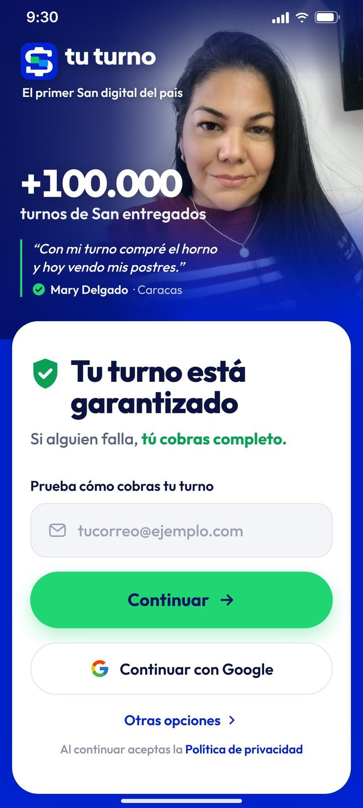

# Pantalla 1 · v20

- [Ver pantalla interactiva](https://tuturno-flujo-venezuela.tiamat-agency.workers.dev/?screen=1)
- [Código y animación](../../src/screens/auth/RegistrationV3.tsx)
- [Resaltados y transiciones compartidos](../../src/flow/motion.tsx)
- [Iconos y paleta](../../src/flow/ui.tsx)
- [Recursos del producto](https://tuturno-flujo-venezuela.tiamat-agency.workers.dev/entrega/)
- [Manifiesto de narración](../../assets/audio/manifest.json)

## Ampliación indicada por Oscar

El carrusel contiene ahora cinco personas de la página venezolana, una cada cinco segundos: Mary Delgado, Carolina Nieves, Deivy Márquez, Bernardo Caldeira y Yenifer Abreu. [Frases, fotos y procedencia](../TESTIMONIOS-INICIO.md).

## Instrucciones aprobadas del documento original

1
Inicio
Reemplaza a H1 «Inicio de sesión», H2 «¿De qué país eres?» y H3 «Ingresa tu correo»
Flujo Venezuela · usuario nuevo
v20 · 17-nov-2026 · página 6 de 25
1 · FINAL
QUÉ HACE
Arriba, la prueba: «+100.000 turnos de San entregados» (sale de la base de
datos y solo sube) y una persona real con su frase, nombre y ciudad.
La garantía: «Tu turno está garantizado» y «Si alguien falla, tú cobras
completo.»
Un solo campo de correo. «Continuar» se activa con un correo válido: si ya
existe, pide la clave; si es nuevo, manda el código y abre la 2.
«Continuar con Google» (con Apple en iPhone) y «Otras opciones».
TUTU DICE
Tutu no habla en esta pantalla.
ANIMACIÓN Y MOVIMIENTO
Sin luz de paseo: solo la respuesta al toque.
El carrusel de personas cambia cada 5 s.
SONIDO
Ninguno.
ÚLTIMO CAMBIO
Sin cambios en la v20. La cifra es una sola en toda la app: «+100.000
turnos entregados».
VA A
2 · Código (o la clave, si el correo ya existe)
PARA LLENAR · OSCAR
Escribe aquí mismo: los campos se pueden llenar.
GitHub · animación
Logos e íconos (enlace)
Colores usados
Observaciones · se evalúan con Maurizio antes de tocar
TuTurno · solo para Oscar
Se implementa tal cual. Correcciones: en «Observaciones», se evalúan con Maurizio.

