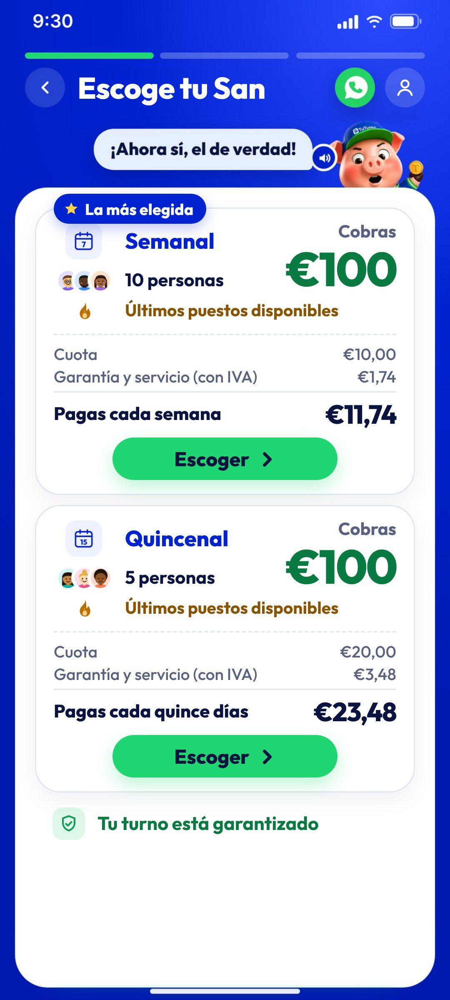

# Pantalla 10-other · v20

- [Ver pantalla interactiva](https://tuturno-flujo-venezuela.tiamat-agency.workers.dev/?screen=10&variant=other)
- [Código y animación](../../src/flow/Flow.tsx)
- [Resaltados y transiciones compartidos](../../src/flow/motion.tsx)
- [Iconos y paleta](../../src/flow/ui.tsx)
- [Recursos del producto](https://tuturno-flujo-venezuela.tiamat-agency.workers.dev/entrega/)
- [Manifiesto de narración](../../assets/audio/manifest.json)

## Instrucciones aprobadas del documento original

10
Escoge tu San
Reemplaza a H9 «Elige tu SAN». H10 «¿Cómo prefieres pagar tu comisión?» se quita para el nuevo.
Flujo Venezuela · usuario nuevo
v20 · 17-nov-2026 · página 18 de 25
10 · FINAL
10 · OTRA · SI TOCÓ «OTRA COSA» (SIN FRASE)
QUÉ HACE
Arriba: flecha, «Escoge tu San», WhatsApp, perfil y Tutu asomado con su nube.
Arriba, su idea completa con su dibujo: «Cobras €100 · para montar tu negocio».
Frase según la idea: Montar mi negocio → «para montar tu negocio» · Hacer crecer
mi negocio → «para hacer crecer tu negocio» · Comprar algo que necesito → «para
comprar algo que necesitas» · Salir de una deuda → «para salir de una deuda» ·
Resolver una emergencia → «para resolver una emergencia» · Otra cosa → sin frase.
Dos tarjetas: Semanal (10 personas, €10 + €1,74 = €11,74 cada semana), con «La más
elegida», y Quincenal (5 personas, €20 + €3,48 = €23,48 cada quince días). Las dos:
«Últimos puestos disponibles».
Al tocar «Escoger» (o la tarjeta) pasa directo a la 11.
Abajo: «Tu turno está garantizado». Ya no va «Si te retiras, pierdes lo que pagaste».
TUTU DICE · TEXTO EXACTO
10
Asomado arriba
¡Ahora sí, el de verdad!
ANIMACIÓN Y MOVIMIENTO
Tutu habla al entrar; vibración suave al tocar una tarjeta.
SONIDO
Voz de Tutu (tutu_10). Nada más.
ÚLTIMO CAMBIO
«La más elegida», «Garantía y servicio», sin «Si te retiras», idea completa.
VA A
11 · Lo que aceptas
PARA LLENAR · OSCAR
Escribe aquí mismo: los campos se pueden llenar.
GitHub · animación
Logos e íconos (enlace)
Colores usados
Observaciones · se evalúan con Maurizio antes de tocar
TuTurno · solo para Oscar
Se implementa tal cual. Correcciones: en «Observaciones», se evalúan con Maurizio.

