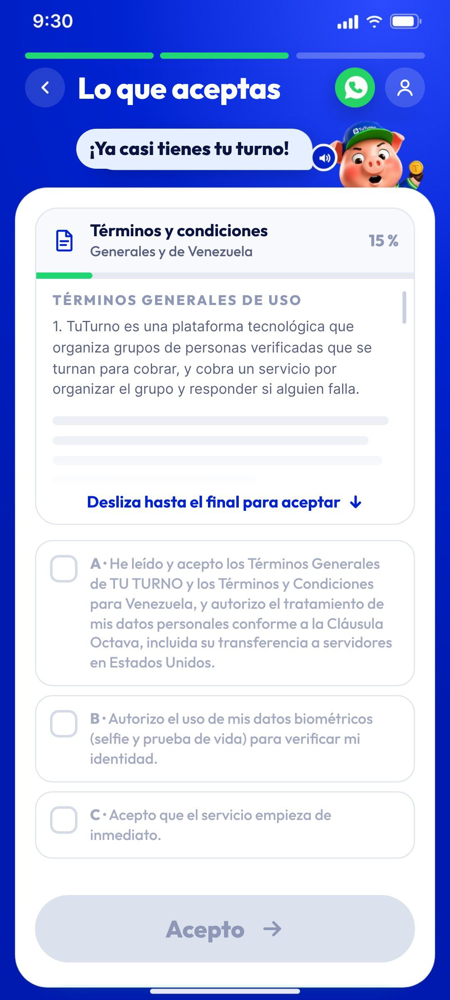

# Pantalla 11 · v20

- [Ver pantalla interactiva](https://tuturno-flujo-venezuela.tiamat-agency.workers.dev/?screen=11)
- [Código y animación](../../src/flow/Flow.tsx)
- [Resaltados y transiciones compartidos](../../src/flow/motion.tsx)
- [Iconos y paleta](../../src/flow/ui.tsx)
- [Recursos del producto](https://tuturno-flujo-venezuela.tiamat-agency.workers.dev/entrega/)
- [Manifiesto de narración](../../assets/audio/manifest.json)

## Instrucciones aprobadas del documento original

11
Lo que aceptas · al llegar
Reemplaza a H11 «Antes de aceptar» y a la ventana de términos de H7
Flujo Venezuela · usuario nuevo
v20 · 17-nov-2026 · página 19 de 25
11 · FINAL · AL LLEGAR
QUÉ HACE
Solo los términos: «Términos y condiciones · Generales y de Venezuela» en una
cajita que se desliza por dentro, con «Desliza hasta el final para aceptar».
Casillas A, B y C apagadas hasta llegar al final. «Acepto» en gris.
La casilla A dice «Términos Generales de TU TURNO», en mayúsculas.
Los textos exactos de las casillas son los del manual de términos v1.3 (los tiene
Limonbyte). Este formato lo pide Colombia y no se cambia.
TUTU DICE · TEXTO EXACTO
11
Asomado arriba
¡Ya casi tienes tu turno!
ANIMACIÓN Y MOVIMIENTO
La barra de la cajita se llena al bajar (15 % … «Leído»).
SONIDO
Voz de Tutu (tutu_11).
ÚLTIMO CAMBIO
Sin cambios en la v20.
VA A
11b · al llegar al final
PARA LLENAR · OSCAR
Escribe aquí mismo: los campos se pueden llenar.
GitHub · animación
Logos e íconos (enlace)
Colores usados
Observaciones · se evalúan con Maurizio antes de tocar
TuTurno · solo para Oscar
Se implementa tal cual. Correcciones: en «Observaciones», se evalúan con Maurizio.

