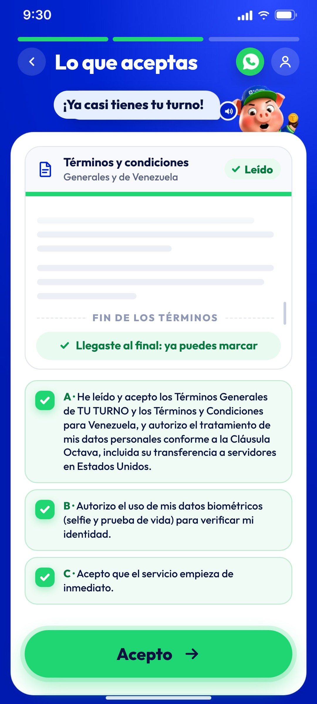

# Screen11b · v20

- [Running state](https://tuturno-flujo-venezuela.tiamat-agency.workers.dev/?screen=11b)
- [Source and animation](../../src/flow/Flow.tsx)
- [Shared highlights and transitions](../../src/flow/motion.tsx)
- [Icons and palette](../../src/flow/ui.tsx)
- [Product resources](https://tuturno-flujo-venezuela.tiamat-agency.workers.dev/entrega/)
- [Narration manifest](../../assets/audio/manifest.json)

## Approved instruction (Spanish source)

11b
Listo para aceptar
Es la misma pantalla de la 11, al llegar al final
Flujo Venezuela · usuario nuevo
v20 · 17-nov-2026 · página 20 de 25
11B · FINAL · LISTO
QUÉ HACE
Al llegar al final: «✓ Leído» y «Llegaste al final: ya puedes marcar».
Cada casilla se pone verde con check y vibración suave.
«Acepto» se enciende con las tres marcadas.
TUTU DICE · TEXTO EXACTO
11B
La misma nube de la 11
¡Ya casi tienes tu turno!
ANIMACIÓN Y MOVIMIENTO
Check verde y vibración suave en cada casilla.
«Acepto» pasa de gris a verde.
SONIDO
La voz suena una vez, al entrar a la 11.
VA A
12 · Tu primer pago
PARA LLENAR · OSCAR
Escribe aquí mismo: los campos se pueden llenar.
GitHub · animación
Logos e íconos (enlace)
Colores usados
Observaciones · se evalúan con Maurizio antes de tocar
TuTurno · solo para Oscar
Se implementa tal cual. Correcciones: en «Observaciones», se evalúan con Maurizio.

