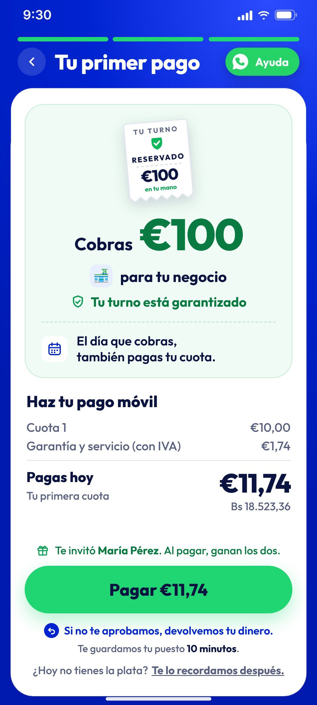

# Pantalla 12 · v20

- [Ver pantalla interactiva](https://tuturno-flujo-venezuela.tiamat-agency.workers.dev/?screen=12)
- [Código y animación](../../src/flow/Flow.tsx)
- [Resaltados y transiciones compartidos](../../src/flow/motion.tsx)
- [Iconos y paleta](../../src/flow/ui.tsx)
- [Recursos del producto](https://tuturno-flujo-venezuela.tiamat-agency.workers.dev/entrega/)
- [Manifiesto de narración](../../assets/audio/manifest.json)

## Instrucciones aprobadas del documento original

12
Tu primer pago
Reemplaza a H12 «Resumen de Pago»
Flujo Venezuela · usuario nuevo
v20 · 17-nov-2026 · página 21 de 25
12 · FINAL
12 · OTRA · SI TOCÓ «OTRA COSA» (SIN FRASE)
QUÉ HACE
Arriba, lo que cobra: el papelito «TU TURNO · RESERVADO · €100», «Cobras €100»,
su idea completa con su dibujo (la misma tabla de la 10; con «Otra cosa» no va), «Tu
turno está garantizado» y «El día que cobras, también pagas tu cuota.»
«Haz tu pago móvil»: Cuota 1 €10,00 · Garantía y servicio (con IVA) €1,74 · Pagas hoy
€11,74 · Bs 18.523,36 (el monto en Bs sale de la orden de ChinChin).
Si vino invitado: «Te invitó María Pérez. Al pagar, ganan los dos.»
«Pagar €11,74» (sin flecha) abre ChinChin. Debajo: «Si no te aprobamos, devolvemos
tu dinero.» y «Te guardamos tu puesto 10 minutos.»
Link «¿Hoy no tienes la plata? Te lo recordamos después.» (va a la 12d). Arriba,
«Ayuda» con WhatsApp.
TUTU DICE
Tutu no sale en el pago.
ANIMACIÓN Y MOVIMIENTO
Sin animación: es el pago real. La celebración va después de pagar.
SONIDO
Ninguno.
ÚLTIMO CAMBIO
«Garantía y servicio» en la factura y la idea completa (17-nov).
VA A
13 · ChinChin
PARA LLENAR · OSCAR
Escribe aquí mismo: los campos se pueden llenar.
GitHub · animación
Logos e íconos (enlace)
Colores usados
Observaciones · se evalúan con Maurizio antes de tocar
TuTurno · solo para Oscar
Se implementa tal cual. Correcciones: en «Observaciones», se evalúan con Maurizio.

