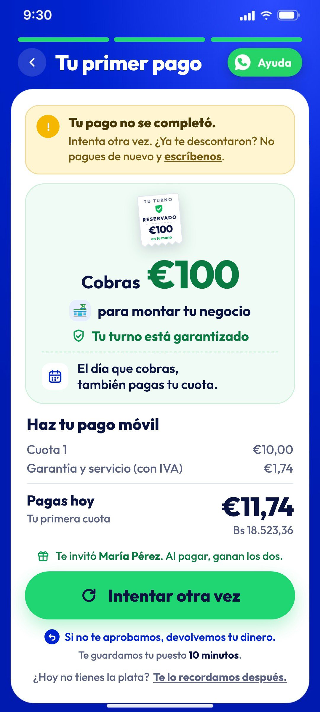

# Screen12c · v20

- [Running state](https://tuturno-flujo-venezuela.tiamat-agency.workers.dev/?screen=12c)
- [Source and animation](../../src/flow/Flow.tsx)
- [Shared highlights and transitions](../../src/flow/motion.tsx)
- [Icons and palette](../../src/flow/ui.tsx)
- [Product resources](https://tuturno-flujo-venezuela.tiamat-agency.workers.dev/entrega/)
- [Narration manifest](../../assets/audio/manifest.json)

## Approved instruction (Spanish source)

12c
Si el pago no se completó
No existe hoy
Flujo Venezuela · usuario nuevo
v20 · 17-nov-2026 · página 22 de 25
12C · FINAL
QUÉ HACE
Si el pago en ChinChin falla o se vence la orden, vuelve a la 12 con su San
guardado y los términos ya aceptados (no al paseo).
Aviso amarillo: «Tu pago no se completó. Intenta otra vez. ¿Ya te descontaron?
No pagues de nuevo y escríbenos.» («escríbenos» abre WhatsApp).
El botón pasa a «Intentar otra vez» y abre ChinChin.
TUTU DICE
Tutu no habla en esta pantalla.
ANIMACIÓN Y MOVIMIENTO
Sin animación.
SONIDO
Ninguno.
ÚLTIMO CAMBIO
«Garantía y servicio» y la idea completa, igual que la 12 (17-nov).
VA A
13 · ChinChin
PARA LLENAR · OSCAR
Escribe aquí mismo: los campos se pueden llenar.
GitHub · animación
Logos e íconos (enlace)
Colores usados
Observaciones · se evalúan con Maurizio antes de tocar
TuTurno · solo para Oscar
Se implementa tal cual. Correcciones: en «Observaciones», se evalúan con Maurizio.

