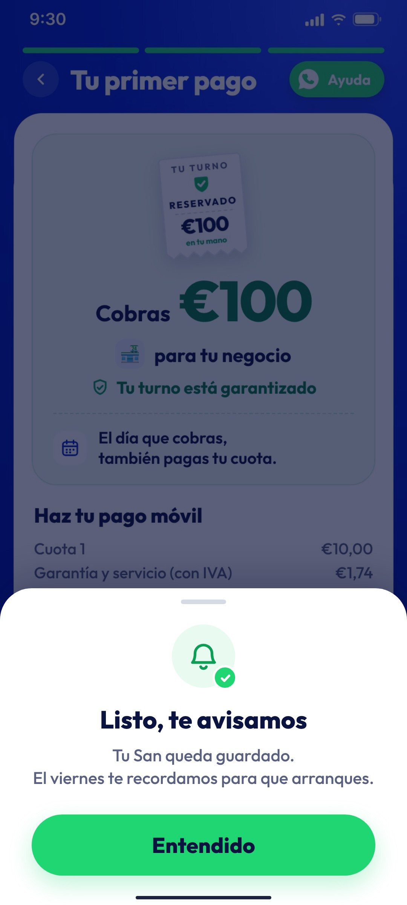

# Screen12d · v20

- [Running state](https://tuturno-flujo-venezuela.tiamat-agency.workers.dev/?screen=12d)
- [Source and animation](../../src/flow/Flow.tsx)
- [Shared highlights and transitions](../../src/flow/motion.tsx)
- [Icons and palette](../../src/flow/ui.tsx)
- [Product resources](https://tuturno-flujo-venezuela.tiamat-agency.workers.dev/entrega/)
- [Narration manifest](../../assets/audio/manifest.json)

## Approved instruction (Spanish source)

12d
Te lo recordamos después
No existe hoy
Flujo Venezuela · usuario nuevo
v20 · 17-nov-2026 · página 23 de 25
12D · FINAL
QUÉ HACE
Sale al tocar «¿Hoy no tienes la plata? Te lo recordamos después.» en la 12.
Si no tiene los avisos activos, antes sale la ventana de permiso del teléfono.
Hoja: «Listo, te avisamos · Tu San queda guardado. El viernes te recordamos
para que arranques.» y «Entendido».
Push los viernes de 6 a 7 pm por 4 semanas; al tocarlo abre directo la 12 con su
San guardado.
TUTU DICE
Tutu no habla en esta pantalla.
ANIMACIÓN Y MOVIMIENTO
La hoja sube desde abajo.
SONIDO
Ninguno.
ÚLTIMO CAMBIO
Atrás se ve la 12 nueva (17-nov).
VA A
Cierra la hoja: el San queda guardado
PARA LLENAR · OSCAR
Escribe aquí mismo: los campos se pueden llenar.
GitHub · animación
Logos e íconos (enlace)
Colores usados
Observaciones · se evalúan con Maurizio antes de tocar
TuTurno · solo para Oscar
Se implementa tal cual. Correcciones: en «Observaciones», se evalúan con Maurizio.

