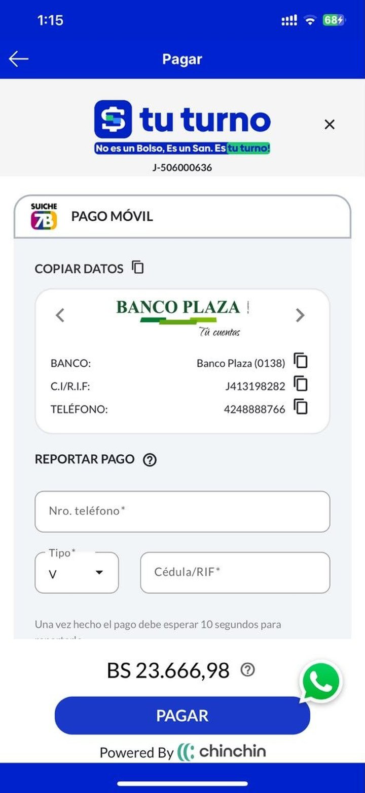

# Pantalla 13 · v20

- [Ver pantalla interactiva](https://tuturno-flujo-venezuela.tiamat-agency.workers.dev/?screen=13)
- [Código y animación](../../src/flow/Flow.tsx)
- [Resaltados y transiciones compartidos](../../src/flow/motion.tsx)
- [Iconos y paleta](../../src/flow/ui.tsx)
- [Recursos del producto](https://tuturno-flujo-venezuela.tiamat-agency.workers.dev/entrega/)
- [Manifiesto de narración](../../assets/audio/manifest.json)

## Instrucciones aprobadas del documento original

13
ChinChin
Es H13: la pantalla es de ChinChin, no es nuestra
Flujo Venezuela · usuario nuevo
v20 · 17-nov-2026 · página 24 de 25
13 · CHINCHIN · NO ES NUESTRA
QUÉ HACE
Es la pasarela de pago de ChinChin. No se rediseña.
Solo se corrige el logo de TuTurno que muestra arriba (hoy dice «No es un
Bolso, Es un San»): va el logo actual.
El monto en Bs tiene que ser idéntico al de la 12. La imagen es de la app de hoy,
con otro monto.
TUTU DICE
Tutu no habla en esta pantalla.
ANIMACIÓN Y MOVIMIENTO
Ninguna: es pantalla de ChinChin.
SONIDO
Ninguno.
LO TUYO AQUÍ
Exporta el logo correcto (SVG y PNG) para que Limonbyte se lo pase a ChinChin.
VA A
Pagó → ¡Listo! (otra entrega) · falló → 12c
PARA LLENAR · OSCAR
Escribe aquí mismo: los campos se pueden llenar.
Logo correcto para
ChinChin (enlace)
Observaciones · se evalúan con Maurizio antes de tocar
TuTurno · solo para Oscar
Se implementa tal cual. Correcciones: en «Observaciones», se evalúan con Maurizio.

