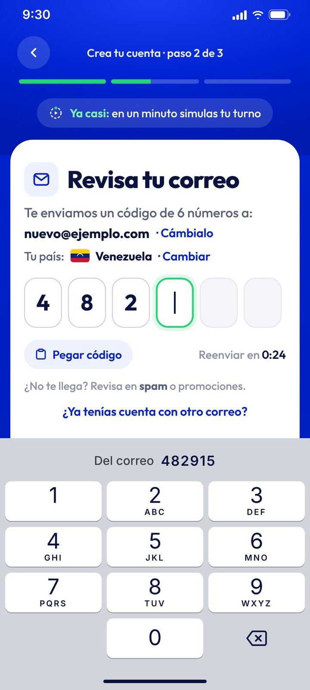

# Pantalla 2 · v20

- [Ver pantalla interactiva](https://tuturno-flujo-venezuela.tiamat-agency.workers.dev/?screen=2)
- [Código y animación](../../src/screens/auth/RegistrationV3.tsx)
- [Resaltados y transiciones compartidos](../../src/flow/motion.tsx)
- [Iconos y paleta](../../src/flow/ui.tsx)
- [Recursos del producto](https://tuturno-flujo-venezuela.tiamat-agency.workers.dev/entrega/)
- [Manifiesto de narración](../../assets/audio/manifest.json)

## Instrucciones aprobadas del documento original

2
Código
Reemplaza a H4 «Revisa tu correo». El país de H2 queda aquí, ya marcado.
Flujo Venezuela · usuario nuevo
v20 · 17-nov-2026 · página 7 de 25
2 · FINAL
QUÉ HACE
Arriba: «Crea tu cuenta · paso 2 de 3» y «Ya casi: en un minuto simulas tu
turno».
El correo con «Cámbialo» y el país: «Tu país: Venezuela · Cambiar».
Seis casillas; el teléfono autocompleta el código. Al sexto número valida y
avanza solo.
Si está malo: rojo, vibración y se borra. «Pegar código». Reenviar a los 30 s.
TUTU DICE
Tutu no habla en esta pantalla.
ANIMACIÓN Y MOVIMIENTO
Sin luz de paseo: solo la respuesta al toque.
SONIDO
Ninguno.
ÚLTIMO CAMBIO
Sin cambios en la v20.
VA A
3 · Clave
PARA LLENAR · OSCAR
Escribe aquí mismo: los campos se pueden llenar.
GitHub · animación
Logos e íconos (enlace)
Colores usados
Observaciones · se evalúan con Maurizio antes de tocar
TuTurno · solo para Oscar
Se implementa tal cual. Correcciones: en «Observaciones», se evalúan con Maurizio.

