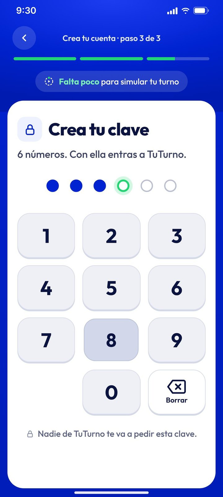

# Pantalla 3 · v20

- [Ver pantalla interactiva](https://tuturno-flujo-venezuela.tiamat-agency.workers.dev/?screen=3)
- [Código y animación](../../src/screens/auth/RegistrationV3.tsx)
- [Resaltados y transiciones compartidos](../../src/flow/motion.tsx)
- [Iconos y paleta](../../src/flow/ui.tsx)
- [Recursos del producto](https://tuturno-flujo-venezuela.tiamat-agency.workers.dev/entrega/)
- [Manifiesto de narración](../../assets/audio/manifest.json)

## Instrucciones aprobadas del documento original

3
Clave
Reemplaza a H5 «Crea tu contraseña»
Flujo Venezuela · usuario nuevo
v20 · 17-nov-2026 · página 8 de 25
3 · FINAL
QUÉ HACE
«Crea tu clave»: 6 números con teclado propio grande (hay usuarios mayores).
Al sexto número, en la misma pantalla: «Repite tu clave». Si no coinciden:
vibración, puntos en rojo y vuelve a empezar.
«Falta poco para simular tu turno» arriba y «Nadie de TuTurno te va a pedir
esta clave» abajo.
TUTU DICE
Tutu no habla en esta pantalla.
ANIMACIÓN Y MOVIMIENTO
La tecla se hunde al tocarla, con vibración ligera.
SONIDO
Ninguno.
ÚLTIMO CAMBIO
Sin cambios en la v20.
VA A
4a · Bienvenida
PARA LLENAR · OSCAR
Escribe aquí mismo: los campos se pueden llenar.
GitHub · animación
Logos e íconos (enlace)
Colores usados
Observaciones · se evalúan con Maurizio antes de tocar
TuTurno · solo para Oscar
Se implementa tal cual. Correcciones: en «Observaciones», se evalúan con Maurizio.

