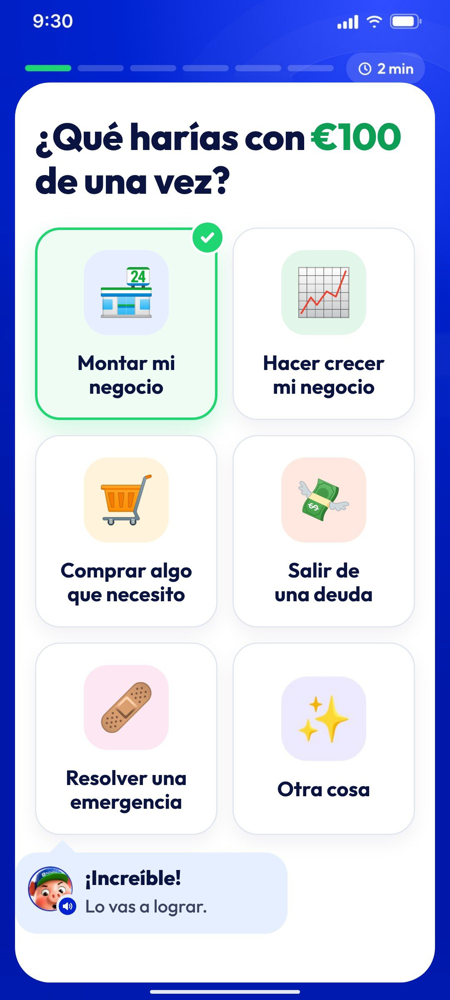

# Screen4a-selected · v20

- [Running state](https://tuturno-flujo-venezuela.tiamat-agency.workers.dev/?screen=4a&variant=selected)
- [Source and animation](../../src/flow/v20.tsx)
- [Shared highlights and transitions](../../src/flow/motion.tsx)
- [Icons and palette](../../src/flow/ui.tsx)
- [Product resources](https://tuturno-flujo-venezuela.tiamat-agency.workers.dev/entrega/)
- [Narration manifest](../../assets/audio/manifest.json)

## Approved instruction (Spanish source)

4a
Bienvenida
Reemplaza a H8 «Inicio de la app» mientras no haya pagado
Flujo Venezuela · usuario nuevo
v20 · 17-nov-2026 · página 9 de 25
4A · AL ENTRAR
4A · AL TOCAR UNA IDEA
QUÉ HACE
«¿Qué harías con €100 de una vez?» y seis ideas con dibujo grande: Montar mi
negocio, Hacer crecer mi negocio, Comprar algo que necesito, Salir de una deuda,
Resolver una emergencia y Otra cosa.
Sin botón: al tocar una idea se pone verde con check, vibra, Tutu dice «¡Increíble! Lo
vas a lograr.» y a 1,5 s pasa sola.
Abajo, chiquito: «¿Te invitaron? Coloca tu código» (hasta que lo coloque o pague; no
sale si llegó por link).
Se guarda la idea que tocó: la usan la 10 y la 12.
TUTU DICE · TEXTO EXACTO
4A
¡Increíble!
Lo vas a lograr.
ANIMACIÓN Y MOVIMIENTO
A los 5 s sin tocar, las ideas laten suave, una vez.
SONIDO
Voz de Tutu al tocar una idea (tutu_4a, nuevo).
ÚLTIMO CAMBIO
Salen la cara de Daniela y «Gente como tú ya cobró su turno» (esa prueba ya sale
en la 1). Ideas nuevas, Tutu reacciona y no hay botón (17-nov).
LO TUYO AQUÍ
Dibujos de referencia: si los rehaces, mismo estilo y grandes.
VA A
4b (si el teléfono pide permiso de avisos) o 4c
PARA LLENAR · OSCAR
Escribe aquí mismo: los campos se pueden llenar.
GitHub · animación
Logos e íconos (enlace)
Colores usados
Observaciones · se evalúan con Maurizio antes de tocar
TuTurno · solo para Oscar
Se implementa tal cual. Correcciones: en «Observaciones», se evalúan con Maurizio.

