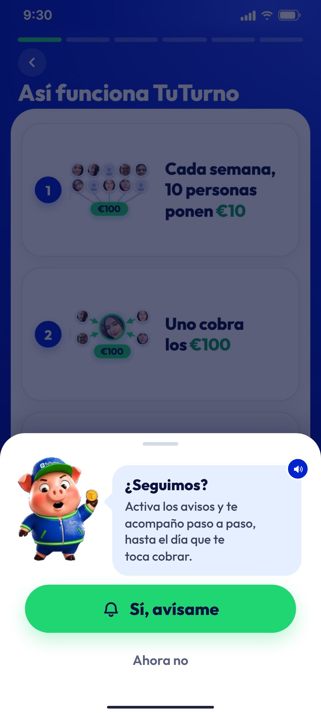

# Pantalla 4b · v20

- [Ver pantalla interactiva](https://tuturno-flujo-venezuela.tiamat-agency.workers.dev/?screen=4b)
- [Código y animación](../../src/flow/Flow.tsx)
- [Resaltados y transiciones compartidos](../../src/flow/motion.tsx)
- [Iconos y paleta](../../src/flow/ui.tsx)
- [Recursos del producto](https://tuturno-flujo-venezuela.tiamat-agency.workers.dev/entrega/)
- [Manifiesto de narración](../../assets/audio/manifest.json)

## Instrucciones aprobadas del documento original

4b
Tutu pide los avisos
No existe hoy (hoy se piden 4 permisos juntos en H6)
Flujo Venezuela · usuario nuevo
v20 · 17-nov-2026 · página 10 de 25
4B · FINAL
QUÉ HACE
Es la ventana del permiso de avisos, con Tutu de cuerpo entero adentro. No es la nube
del paseo.
Sale después de tocar una idea, encima de la 4c, solo si el teléfono pide permiso
(Android 13+ y iPhone).
«Sí, avísame» abre el permiso del teléfono. «Ahora no» (chiquito) sigue a la 4c.
Si dice que no, la segunda oportunidad es el link «¿Hoy no tienes la plata?» de la 12.
TUTU DICE · TEXTO EXACTO
4B
¿Seguimos?
Activa los avisos y te acompaño paso a paso, hasta el día que te toca cobrar.
ANIMACIÓN Y MOVIMIENTO
La ventana sube desde abajo; atrás queda la 4c bajo el velo.
SONIDO
Voz de Tutu (tutu_4b, se regraba).
ÚLTIMO CAMBIO
Título «¿Seguimos?» y mensaje nuevo. El botón sigue «Sí, avísame», para que se
entienda que es un permiso (17-nov).
VA A
4c · Así funciona TuTurno
PARA LLENAR · OSCAR
Escribe aquí mismo: los campos se pueden llenar.
GitHub · animación
Logos e íconos (enlace)
Colores usados
Observaciones · se evalúan con Maurizio antes de tocar
TuTurno · solo para Oscar
Se implementa tal cual. Correcciones: en «Observaciones», se evalúan con Maurizio.

