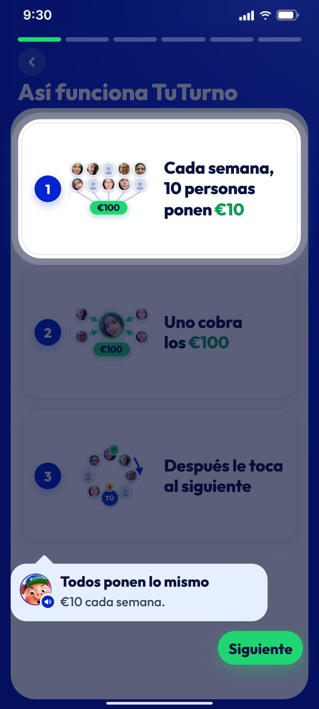

# Screen4c-1 · v20

- [Running state](https://tuturno-flujo-venezuela.tiamat-agency.workers.dev/?screen=4c)
- [Source and animation](../../src/flow/v20.tsx)
- [Shared highlights and transitions](../../src/flow/motion.tsx)
- [Icons and palette](../../src/flow/ui.tsx)
- [Product resources](https://tuturno-flujo-venezuela.tiamat-agency.workers.dev/entrega/)
- [Narration manifest](../../assets/audio/manifest.json)

## Approved instruction (Spanish source)

4c
Así funciona TuTurno
No existe hoy
Flujo Venezuela · usuario nuevo
v20 · 17-nov-2026 · página 11 de 25
4C · SIN RESALTAR
4C · 1 · PASO 1
4C · 2 · PASO 2
4C · 3 · PASO 3
QUÉ HACE
Título «Así funciona TuTurno». Flecha de atrás para cambiar de idea.
Tres pasos grandes y numerados: 1 «Cada semana, 10 personas ponen €10» · 2 «Uno
cobra los €100» · 3 «Después le toca al siguiente».
La luz pasa por cada paso con el «Siguiente» de la nube; con el del paso 3 pasa sola a
la 5.
TUTU DICE · TEXTO EXACTO
4C·1
Todos ponen lo mismo
€10 cada semana.
4C·2
Uno cobra todo junto
Los €100 de una vez.
4C·3
Después le toca al siguiente
Todos cobran. Tú también.
ANIMACIÓN Y MOVIMIENTO
La luz llega 1 s después (o al cerrar la 4b) y se desliza entre pasos. Nube de 290 de
ancho; «Siguiente» debajo, a la derecha.
SONIDO
Voz de Tutu en cada paso (tutu_4c_1 a tutu_4c_3, nuevos).
ÚLTIMO CAMBIO
Salen la cara, el código, la idea con «Cambiar» y «Cobrar mi turno» (17-nov).
VA A
5 · Así pagas tu San
PARA LLENAR · OSCAR
Escribe aquí mismo: los campos se pueden llenar.
GitHub · animación
Logos e íconos (enlace)
Colores usados
Observaciones · se evalúan con Maurizio antes de tocar
TuTurno · solo para Oscar
Se implementa tal cual. Correcciones: en «Observaciones», se evalúan con Maurizio.

