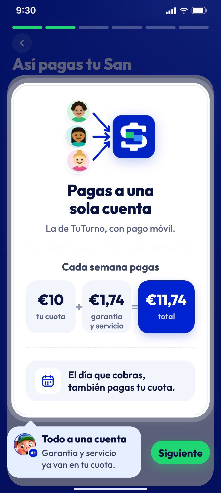

# Screen5-guide · v20

- [Running state](https://tuturno-flujo-venezuela.tiamat-agency.workers.dev/?screen=5)
- [Source and animation](../../src/flow/Flow.tsx)
- [Shared highlights and transitions](../../src/flow/motion.tsx)
- [Icons and palette](../../src/flow/ui.tsx)
- [Product resources](https://tuturno-flujo-venezuela.tiamat-agency.workers.dev/entrega/)
- [Narration manifest](../../assets/audio/manifest.json)

## Approved instruction (Spanish source)

5
Así pagas tu San
No existe hoy
Flujo Venezuela · usuario nuevo
v20 · 17-nov-2026 · página 12 de 25
5 · SIN RESALTAR
5 · CON RESALTADO · 1 S DESPUÉS
QUÉ HACE
Una tarjeta que llena la hoja blanca: las caritas le pagan a la cuenta de
TuTurno. «Pagas a una sola cuenta · La de TuTurno, con pago móvil.»
«Cada semana pagas»: €10 tu cuota + €1,74 garantía y servicio = €11,74 total.
«El día que cobras, también pagas tu cuota.»
TUTU DICE · TEXTO EXACTO
5
Todo a una cuenta
Garantía y servicio ya van en tu cuota.
ANIMACIÓN Y MOVIMIENTO
1 s después de entrar llega la luz a la tarjeta y sale la nube de Tutu, abajo.
SONIDO
Voz de Tutu (tutu_5, se regraba).
ÚLTIMO CAMBIO
Debajo del €1,74 dice «garantía y servicio»: el cobro tiene un solo nombre
en la 5, la 7, la 10 y la 12. La nube dice lo mismo (17-nov).
VA A
6 · Reglas (con «Siguiente»)
PARA LLENAR · OSCAR
Escribe aquí mismo: los campos se pueden llenar.
GitHub · animación
Logos e íconos (enlace)
Colores usados
Observaciones · se evalúan con Maurizio antes de tocar
TuTurno · solo para Oscar
Se implementa tal cual. Correcciones: en «Observaciones», se evalúan con Maurizio.

