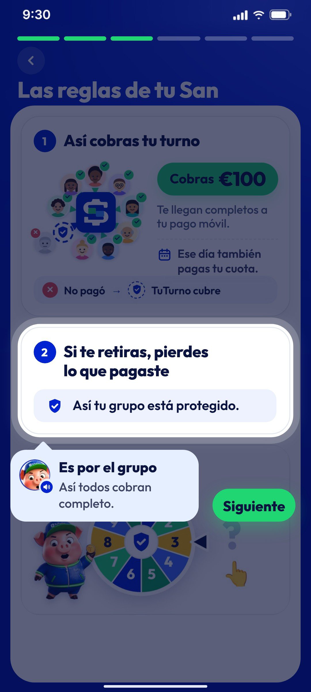

# Screen6-2 · v20

- [Running state](https://tuturno-flujo-venezuela.tiamat-agency.workers.dev/?screen=6&variant=guide2)
- [Source and animation](../../src/flow/Flow.tsx)
- [Shared highlights and transitions](../../src/flow/motion.tsx)
- [Icons and palette](../../src/flow/ui.tsx)
- [Product resources](https://tuturno-flujo-venezuela.tiamat-agency.workers.dev/entrega/)
- [Narration manifest](../../assets/audio/manifest.json)

## Approved instruction (Spanish source)

6
Las reglas de tu San
No existe hoy
Flujo Venezuela · usuario nuevo
v20 · 17-nov-2026 · página 13 de 25
6 · SIN RESALTAR
6 · 1 · PUNTO 1
6 · 2 · PUNTO 2
6 · 3 · PUNTO 3
QUÉ HACE
Tres tarjetas fijas: 1 «Así cobras tu turno», 2 «Si te retiras, pierdes lo que pagaste · Así
tu grupo está protegido.» y 3 «Simula tu turno».
La luz pasa por la 1, la 2 y la 3, una por cada «Siguiente».
TUTU DICE · TEXTO EXACTO
6·1
De una sola cuenta
TuTurno te manda los €100.
6·2
Es por el grupo
Así todos cobran completo.
6·3
¡Pruébalo tú!
Toca y mira cómo llega tu turno.
ANIMACIÓN Y MOVIMIENTO
La luz llega 1 s después de entrar y se desliza (≈ 0,3 s) de una tarjeta a otra.
Rueda: al tocarla gira ≈ 2 s y para en un número al azar del 1 al 10, con confeti y
vibración. Se puede volver a girar (lo revisó Alejandra).
SONIDO
Voz de Tutu en cada nube. La rueda no suena.
ÚLTIMO CAMBIO
Sin cambios. «Si te retiras, pierdes lo que pagaste» queda solo aquí: sale de la 10
(17-nov).
VA A
7 · Practica tu primer pago
PARA LLENAR · OSCAR
Escribe aquí mismo: los campos se pueden llenar.
GitHub · animación
Logos e íconos (enlace)
Colores usados
Observaciones · se evalúan con Maurizio antes de tocar
TuTurno · solo para Oscar
Se implementa tal cual. Correcciones: en «Observaciones», se evalúan con Maurizio.

