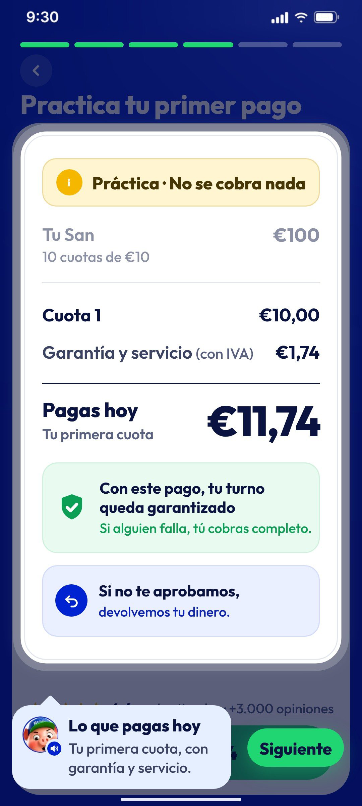

# Pantalla 7-guide · v20

- [Ver pantalla interactiva](https://tuturno-flujo-venezuela.tiamat-agency.workers.dev/?screen=7&variant=guide)
- [Código y animación](../../src/flow/v20.tsx)
- [Resaltados y transiciones compartidos](../../src/flow/motion.tsx)
- [Iconos y paleta](../../src/flow/ui.tsx)
- [Recursos del producto](https://tuturno-flujo-venezuela.tiamat-agency.workers.dev/entrega/)
- [Manifiesto de narración](../../assets/audio/manifest.json)

## Instrucciones aprobadas del documento original

7
Practica tu primer pago
No existe hoy
Flujo Venezuela · usuario nuevo
v20 · 17-nov-2026 · página 14 de 25
7 · SIN RESALTAR
7 · CON RESALTADO · 1 S DESPUÉS
QUÉ HACE
Arriba, en grande: «Práctica · No se cobra nada».
Factura de práctica: Tu San €100 (10 cuotas de €10) · Cuota 1 €10,00 · Garantía y
servicio (con IVA) €1,74 · Pagas hoy €11,74.
Recuadros: verde (garantía) y azul («Si no te aprobamos, devolvemos tu dinero.»).
Calificación «4,6 en las tiendas · +3.000 opiniones» y «Pagar €11,74», sin flecha, igual
que en la 12. Aquí no cobra nada.
Orden: luz y nube → «Siguiente» → se va la luz → toca «Pagar €11,74» → 7b.
TUTU DICE · TEXTO EXACTO
7
Lo que pagas hoy
Tu primera cuota, con garantía y servicio.
ANIMACIÓN Y MOVIMIENTO
Luz en la tarjeta 1 s después de entrar.
La nube va abajo y tapa la calificación y el botón: es a propósito, manda el
«Siguiente» de la nube.
SONIDO
Voz de Tutu (tutu_7, se regraba).
ÚLTIMO CAMBIO
Título «Practica tu primer pago». El aviso amarillo sube arriba: «Práctica · No se
cobra nada» (sin «hoy», para que no crea que hoy no paga). «Garantía y servicio»
en la factura (17-nov).
VA A
7b · Práctica superada
PARA LLENAR · OSCAR
Escribe aquí mismo: los campos se pueden llenar.
GitHub · animación
Logos e íconos (enlace)
Colores usados
Observaciones · se evalúan con Maurizio antes de tocar
TuTurno · solo para Oscar
Se implementa tal cual. Correcciones: en «Observaciones», se evalúan con Maurizio.

