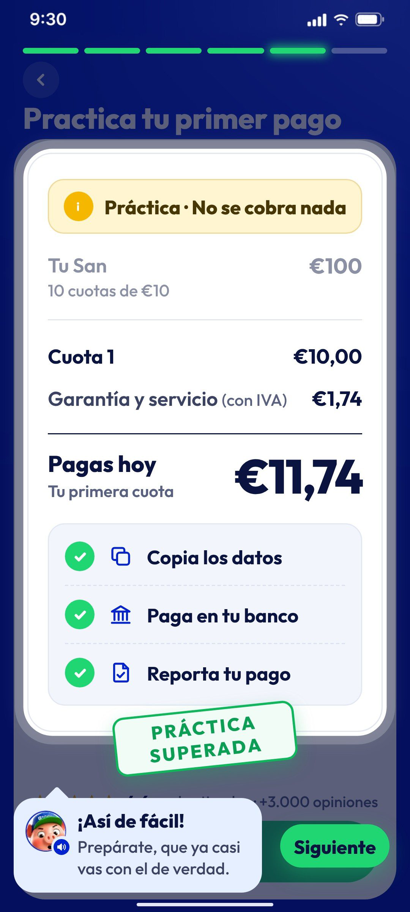

# Pantalla 7b-guide · v20

- [Ver pantalla interactiva](https://tuturno-flujo-venezuela.tiamat-agency.workers.dev/?screen=7b&variant=guide)
- [Código y animación](../../src/flow/v20.tsx)
- [Resaltados y transiciones compartidos](../../src/flow/motion.tsx)
- [Iconos y paleta](../../src/flow/ui.tsx)
- [Recursos del producto](https://tuturno-flujo-venezuela.tiamat-agency.workers.dev/entrega/)
- [Manifiesto de narración](../../assets/audio/manifest.json)

## Instrucciones aprobadas del documento original

7b
Práctica superada
No existe hoy
Flujo Venezuela · usuario nuevo
v20 · 17-nov-2026 · página 15 de 25
7B · SIN RESALTAR
7B · CON RESALTADO · 1 S DESPUÉS
QUÉ HACE
Al tocar «Pagar», debajo de la factura salen los tres pasos del pago de verdad y se
marcan solos, uno por uno: «Copia los datos», «Paga en tu banco» y «Reporta tu
pago».
Después cae el sello «PRÁCTICA SUPERADA», abajo de la tarjeta, y el botón pasa a
«Siguiente».
Arriba sigue «Práctica · No se cobra nada». La factura no se mueve.
Los recuadros verde y azul de la 7 no salen aquí: ese lugar lo ocupan los tres pasos.
TUTU DICE · TEXTO EXACTO
7B
¡Así de fácil!
Prepárate, que ya casi vas con el de verdad.
ANIMACIÓN Y MOVIMIENTO
Cada paso se ilumina un segundo y recibe su check, con el mismo resaltado de la 5 y la
6; el usuario no toca nada.
Al terminar el tercero, el sello cae pequeño y se asienta, con vibración suave. La
barra brilla una vez. Luz y nube 1 s después.
SONIDO
Voz de Tutu (tutu_7b). El sello y los checks no suenan.
ÚLTIMO CAMBIO
Tres pasos que se marcan solos, sello «Práctica superada» (antes «¡Listo! Pago de
práctica») y botón «Siguiente» (antes «Listo») (17-nov).
VA A
8 · Aquí todos están verificados
PARA LLENAR · OSCAR
Escribe aquí mismo: los campos se pueden llenar.
GitHub · animación
Logos e íconos (enlace)
Colores usados
Observaciones · se evalúan con Maurizio antes de tocar
TuTurno · solo para Oscar
Se implementa tal cual. Correcciones: en «Observaciones», se evalúan con Maurizio.

