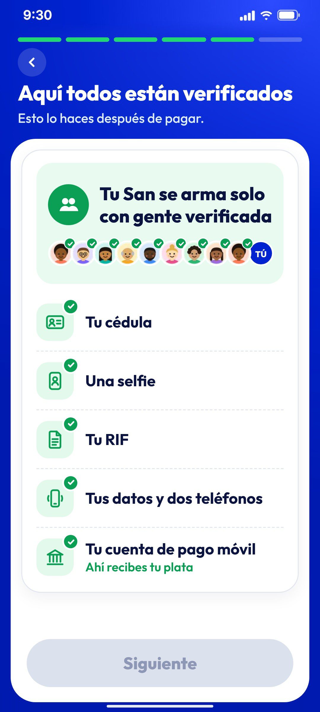

# Pantalla 8 · v20

- [Ver pantalla interactiva](https://tuturno-flujo-venezuela.tiamat-agency.workers.dev/?screen=8)
- [Código y animación](../../src/flow/v20.tsx)
- [Resaltados y transiciones compartidos](../../src/flow/motion.tsx)
- [Iconos y paleta](../../src/flow/ui.tsx)
- [Recursos del producto](https://tuturno-flujo-venezuela.tiamat-agency.workers.dev/entrega/)
- [Manifiesto de narración](../../assets/audio/manifest.json)

## Instrucciones aprobadas del documento original

8
Aquí todos están verificados
No existe hoy
Flujo Venezuela · usuario nuevo
v20 · 17-nov-2026 · página 16 de 25
8 · SIGUIENTE GRIS
8 · CON RESALTADO
8 · FIN · AL TOCAR SIGUIENTE
QUÉ HACE
«Aquí todos están verificados · Esto lo haces después de pagar.»
Arriba, en grande: «Tu San se arma solo con gente verificada», 9 caritas y «TÚ».
Debajo, más chica: Tu cédula · Una selfie · Tu RIF · Tus datos y dos teléfonos · Tu cuenta
de pago móvil («Ahí recibes tu plata»). El RIF es obligatorio.
«Siguiente» va gris mientras corre la animación. Al tocar «Siguiente» en la nube se
pone verde (8 · fin) y lleva a la 9.
TUTU DICE · TEXTO EXACTO
8
Solo una vez
Falta lo mejor: tu turno.
ANIMACIÓN Y MOVIMIENTO
Con la luz, primero las caritas reciben su check («TÚ» queda sin check); después cada
cosa de la lista se marca en verde, una cada 0,15 s. Vibración suave al final.
La nube va abajo y tapa el botón: es a propósito.
SONIDO
Voz de Tutu (tutu_8). Los checks no suenan.
ÚLTIMO CAMBIO
Título nuevo, el grupo con las caras sube arriba en grande, la lista baja más chica
y el botón dice «Siguiente» (antes «Empezar») (17-nov).
VA A
9 · ¡Ya sabes cómo cobrar tus €100!
PARA LLENAR · OSCAR
Escribe aquí mismo: los campos se pueden llenar.
GitHub · animación
Logos e íconos (enlace)
Colores usados
Observaciones · se evalúan con Maurizio antes de tocar
TuTurno · solo para Oscar
Se implementa tal cual. Correcciones: en «Observaciones», se evalúan con Maurizio.

