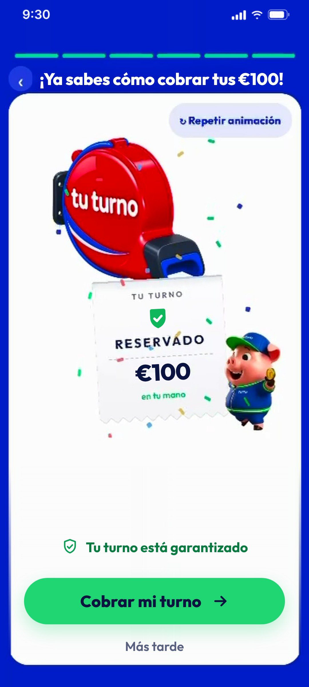

# Pantalla 9 · v20

- [Ver pantalla interactiva](https://tuturno-flujo-venezuela.tiamat-agency.workers.dev/?screen=9)
- [Código y animación](../../src/flow/Flow.tsx)
- [Resaltados y transiciones compartidos](../../src/flow/motion.tsx)
- [Iconos y paleta](../../src/flow/ui.tsx)
- [Recursos del producto](https://tuturno-flujo-venezuela.tiamat-agency.workers.dev/entrega/)
- [Manifiesto de narración](../../assets/audio/manifest.json)

## Instrucciones aprobadas del documento original

9
¡Ya sabes cómo cobrar tus €100!
No existe hoy
Flujo Venezuela · usuario nuevo
v20 · 17-nov-2026 · página 17 de 25
9 · FINAL
QUÉ HACE
La tiquetera roja «tu turno» entrega el papelito «TU TURNO · RESERVADO ·
€100 en tu mano».
«Tu turno está garantizado», «Cobrar mi turno» (va a la 10) y «Más tarde»
(vuelve a la 4a).
«↻ Repetir animación» arriba a la derecha.
TUTU DICE · TEXTO EXACTO
9
Sin nube: solo la voz
¡Ya sabes cómo cobrar tus €100!
ANIMACIÓN Y MOVIMIENTO
Al entrar, una vez: gira el rollo, suena el «ri-ri-ri», baja el papelito (≈ 1 s) con
vibración, «RESERVADO» late, Tutu celebra y sale confeti.
Entrégala por capas: cuerpo, vidrio, rollo, boca, papelito, confeti y Tutu.
SONIDO
El «ri-ri-ri» de la impresora y la voz de Tutu (tutu_9, se regraba).
ÚLTIMO CAMBIO
Titular nuevo: «¡Ya sabes cómo cobrar tus €100!» (17-nov).
VA A
10 · Escoge tu San
PARA LLENAR · OSCAR
Escribe aquí mismo: los campos se pueden llenar.
GitHub · animación
Logos e íconos (enlace)
Colores usados
Observaciones · se evalúan con Maurizio antes de tocar
TuTurno · solo para Oscar
Se implementa tal cual. Correcciones: en «Observaciones», se evalúan con Maurizio.

