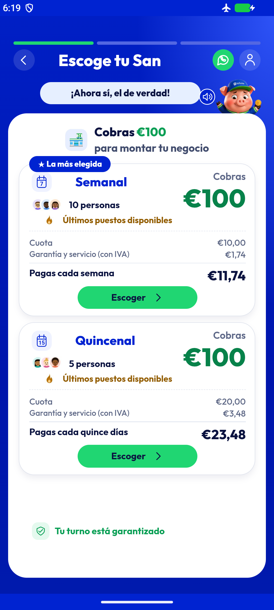

# Verificación del APK v20.0.1

Compilación realizada en **node01** a partir de `4aca139453d5ece72f758d1ceb0917c6e20a7a85`, con recursos locales y sin Expo.

- APK: `TuTurno-v20-Android.apk`.
- SHA256: `a5b2cb6f9ab3dd7b9b6fa45800f5faefce6f592d7e2628b5d1b730da781c8e80`.
- Firma APK v2 comprobada con `apksigner verify`.
- `npm run check`, compilación Android y `:app:lintDebug`: correctos.
- Prueba del recorrido: [resultado estructurado](recorrido.json), generado por `npm run android:verificar`.
- Entorno: emulador Android 17, sin conexión y con WebView local. No se ha probado en un teléfono físico.

Se comprueban el inicio, el registro de demostración, la elección de idea, el paseo guiado, la rueda, el pago de práctica, la verificación, la salida del tiquete, su repetición y la selección del San. La prueba exige reproducción de voz, conservación del silencio, confeti animado según la v20, ausencia de errores JavaScript y ausencia de recursos remotos.

| Inicio | Tiquetera | Escoge tu San |
| --- | --- | --- |
|  |  |  |
